# Plan de la Fase 2 — Recetario Digital Profesional

- **Fecha:** 2026-10-28
- **Estado:** propuesta para que la apruebe Joaco. **No se construye nada** hasta que Soy apruebe la demo de la Fase 1 (compuerta de [fase-1.md](fase-1.md), sección 12), que espera el ambiente de prueba.
- **Fuentes:**
  - el documento de Soy, [fase-2-recetario.md](fase-2-recetario.md), que **manda sobre este plan**;
  - el prompt maestro;
  - lo construido en la Fase 1 (migraciones hasta `20261023150000`, ADR-0001 a ADR-0018).
- **Responde** al prompt de arranque de la sección 24 del documento de Soy, en el mismo orden de 7 puntos.

## Resumen para Soy

El recetario se apoya en lo que ya funciona de la Fase 1:

- quién es cada persona y qué puede hacer;
- quién aprueba;
- el historial que no se borra.

Le agrega cinco partes nuevas:

1. **Materias primas**: qué se compra, a qué ingrediente corresponde y cuánto rinde.
2. **Precios**: nunca se pisan, cada cambio es un registro nuevo.
3. **Recetas**: con versiones que no se tocan una vez publicadas.
4. **Motor de costos**: calcula en la base, igual para todos.
5. **Importación de Excel**: con revisión antes de entrar.

Se construye en 5 etapas. Cada una termina con sus pruebas en verde antes de pasar a la siguiente.

Antes de empezar hacen falta **las 8 decisiones de la sección 22** y **6 preguntas nuevas** (punto 7 de este plan).

---

## 1. Arquitectura y cómo se apoya en la Fase 1

### Lo que se reutiliza sin duplicar

| Necesidad del recetario        | Lo que ya existe (Fase 1)                                                                                       |
| ------------------------------ | --------------------------------------------------------------------------------------------------------------- |
| Grupo, marca, establecimiento  | `org.groups`, `org.brands`, `org.restaurants` (se agrega `site_type`)                                           |
| Quién puede qué y dónde        | `core.has_permission_for_scope` y sus versiones de conjunto (`permitted_restaurant_ids`, ADR-0012)              |
| Aprobaciones con otra persona  | `workflow.approval_workflows` + `request_approval` + `decide_approval`, con `apply_function` por tipo de cambio |
| Historial inalterable          | Trigger `audit.log_change()` en cada tabla nueva, con motivo y origen por `core.set_change_context`             |
| Columnas de control            | Trigger `core.set_control_columns`                                                                              |
| Avisos al que aprueba          | `core.notifications`                                                                                            |
| Local activo de la sesión      | `core.my_active_restaurant` / `set_active_restaurant` (el selector de arriba)                                   |
| Ocultar costos en el historial | `core.can_see_costs` / `core.hide_costs` (se ajustan, ver pregunta N1)                                          |

### Reglas de diseño que se heredan (ADR-0005, ADR-0012, plan de la Fase 1)

1. **RLS en la misma migración que crea la tabla.** Ninguna tabla existe sin RLS, ni por un momento.
2. **La API solo lee.**
   - `authenticated` tiene `select` con RLS.
   - Toda escritura va por funciones (RPC) que validan el permiso, fijan motivo y origen, y dejan que los triggers completen control y auditoría.
   - Nunca `delete`: el borrado es lógico.
3. **Políticas con conjuntos de ids** (`restaurant_id in (select core.permitted_restaurant_ids('recipes.view'))`), nunca una función por fila.
4. **Alcance consistente por estructura:** claves foráneas compuestas `(restaurant_id, group_id)` y `(brand_id, group_id)`.
5. **Vistas con `security_invoker = true`.**
6. **Solo inserción** donde el documento lo pide: precios, ensayos, snapshots y sus líneas. Sin GRANT de `update`, más un trigger que rechaza `update` y `delete`, igual que `audit.audit_events`.

### Dónde vive cada cosa

- **El cálculo** está en la base, en funciones SQL deterministas del esquema `costing`. La app solo muestra el resultado; nunca calcula costos en el navegador.
- **La propagación de precios** también está en la base:
  1. el precio aprobado se inserta;
  2. un trigger encola las recetas afectadas;
  3. la misma transacción procesa la cola de abajo hacia arriba;
  4. se escribe el evento en `integration.integration_outbox`.

  Si un día el volumen lo pide, el procesamiento pasa a `pg_cron`, que ya está instalado.

- **El snapshot de fin de mes** corre por `pg_cron`.
- **Fotos y documentos:** en Supabase Storage, en un bucket privado `recipes`, con carpetas `{group_id}/{recipe_id}/…`. Las políticas de Storage llaman a la misma regla de permisos de la receta.
- **Excel** se lee y se arma en el servidor (Server Actions de Next). Las filas se cargan a `imports.import_staging_rows` y la validación es SQL.

### Esquemas

Se crean dos esquemas nuevos: `imports` e `integration`. El prompt maestro no los tenía (pregunta N4).

Se exponen por la API, en `api.schemas` de `supabase/config.toml`, los esquemas `catalog`, `costing`, `recipes` e `imports`. `integration` **no se expone**: solo lo leen funciones de servidor y, en el futuro, los agentes por su cuenta técnica.

---

## 2. Diagrama de entidades y relaciones

Los nombres llevan el esquema como prefijo (`catalog_ingredients` = `catalog.ingredients`). Se muestran solo las relaciones principales. Todas las tablas de negocio tienen además `group_id` y las columnas de control.

```mermaid
erDiagram
    org_groups ||--o{ org_brands : tiene
    org_brands ||--o{ org_restaurants : tiene

    catalog_units ||--o{ catalog_unit_conversions : "de / a"
    catalog_ingredient_categories ||--o{ catalog_ingredients : clasifica
    catalog_ingredients ||--o{ catalog_ingredient_aliases : "se llama también"
    catalog_ingredients ||--o{ catalog_ingredient_unit_conversions : "densidad o peso por unidad"
    catalog_ingredients ||--o{ catalog_purchase_products : "se compra como"
    catalog_suppliers |o--o{ catalog_purchase_products : "suele vender"
    catalog_ingredients ||--o{ catalog_ingredient_allergens : declara
    catalog_allergens ||--o{ catalog_ingredient_allergens : en
    catalog_yield_processes ||--o{ catalog_ingredient_yield_profiles : proceso
    catalog_ingredients ||--o{ catalog_ingredient_yield_profiles : rinde
    catalog_ingredient_yield_profiles ||--o{ catalog_ingredient_yield_tests : "se mide en"

    catalog_purchase_products ||--o{ costing_price_records : "tiene precios"
    catalog_suppliers |o--o{ costing_price_records : cotiza
    org_restaurants |o--o{ costing_price_records : "alcance local"
    costing_tax_policies }o--|| org_restaurants : "aplica a"
    costing_price_selection_policies }o--|| org_groups : "por alcance"

    recipes_recipe_categories ||--o{ recipes_recipes : clasifica
    recipes_recipes ||--o{ recipes_recipe_versions : versiones
    recipes_recipes |o--o{ recipes_recipes : "variante de"
    recipes_recipe_versions ||--o{ recipes_recipe_components : lineas
    catalog_ingredients |o--o{ recipes_recipe_components : "ingrediente"
    recipes_recipe_versions |o--o{ recipes_recipe_components : "subreceta (version atada)"
    catalog_ingredient_yield_profiles |o--o{ recipes_recipe_components : "rendimiento aplicado"
    recipes_recipe_versions ||--o{ recipes_recipe_steps : pasos
    recipes_recipe_steps ||--o{ recipes_recipe_step_dependencies : "espera a"
    recipes_recipe_versions ||--o{ recipes_recipe_yield_tests : "se mide en"
    recipes_recipes ||--o{ recipes_recipe_assignments : "se usa en"
    org_restaurants ||--o{ recipes_recipe_assignments : usa
    recipes_recipes ||--o{ recipes_recipe_tag_links : etiquetas
    recipes_recipe_tags ||--o{ recipes_recipe_tag_links : en
    recipes_recipes ||--o{ recipes_recipe_media : fotos
    recipes_recipes ||--o{ recipes_recipe_comments : comentarios

    recipes_recipe_versions ||--o{ costing_recipe_cost_current : "costo vigente por local"
    org_restaurants ||--o{ costing_recipe_cost_current : en
    recipes_recipe_versions ||--o{ costing_recipe_cost_snapshots : fotos
    costing_recipe_cost_snapshots ||--o{ costing_recipe_cost_snapshot_lines : lineas
    costing_price_records |o--o{ costing_recipe_cost_snapshot_lines : "precio usado"
    recipes_recipe_versions ||--o{ costing_cost_recalc_queue : "pendiente de recalcular"
    costing_cost_scenarios ||--o{ costing_cost_scenario_overrides : cambios

    imports_import_jobs ||--o{ imports_import_staging_rows : filas
    imports_import_jobs ||--o{ imports_import_errors : errores
    imports_import_column_mappings }o--|| org_groups : recuerda

    workflow_approval_requests |o--o{ recipes_recipe_versions : "aprueba"
    workflow_approval_requests |o--o{ costing_price_records : "aprueba"
    integration_integration_outbox }o--|| org_groups : eventos
```

---

## 3. Diccionario inicial de datos

Es la versión de diseño. El diccionario completo (tipos exactos, índices, restricciones y alcance de acceso por tabla) se **genera desde la base** en `docs/modulos/02-recetario-diccionario.md` al cerrar cada etapa, como pide la sección 7.

Las columnas de control (`created_*`, `updated_*`, `deleted_*`) y `group_id` van en todas las tablas de negocio y no se repiten abajo.

**Leyenda:**

- **SI** = solo inserción.
- **Lee** = permiso de lectura por RLS.
- **Escribe** = RPC y permiso.

### `catalog`

| Tabla                         | Para qué                                               | Columnas principales                                                                                                                                                                                                                    | Reglas                                                                                                                  | Lee / Escribe                                                      |
| ----------------------------- | ------------------------------------------------------ | --------------------------------------------------------------------------------------------------------------------------------------------------------------------------------------------------------------------------------------- | ----------------------------------------------------------------------------------------------------------------------- | ------------------------------------------------------------------ |
| `units`                       | Unidades de medida (referencia global, sin `group_id`) | `code` (`g`, `kg`, `ml`, `l`, `unit`, `dozen`, `pack`, `box`, `bag`, `bottle`, `can`, `bunch`), `name_es`, `dimension` (masa, volumen, conteo, envase)                                                                                  | Las de envase **no tienen contenido fijo**: siempre necesitan el dato del producto                                      | Todos / migración                                                  |
| `unit_conversions`            | Conversión universal dentro de una dimensión           | `from_unit_id`, `to_unit_id`, `factor`                                                                                                                                                                                                  | Solo dentro de la misma dimensión (check)                                                                               | Todos / migración                                                  |
| `ingredient_categories`       | Categoría y subcategoría                               | `parent_id`, `name`, `stale_price_days`                                                                                                                                                                                                 | Plazo de precio desactualizado por categoría (decisión 7)                                                               | `catalog.view` / `catalog.manage`                                  |
| `ingredients`                 | El ingrediente gastronómico                            | `code` (único por grupo), `name`, `category_id`, unidades de compra, uso, almacenamiento y costeo, `is_active`                                                                                                                          | No se borra si alguna versión lo usó: se desactiva                                                                      | `catalog.view` / `catalog.manage`                                  |
| `ingredient_aliases`          | Otros nombres, para buscar e importar                  | `ingredient_id`, `alias`                                                                                                                                                                                                                | Índice `pg_trgm`                                                                                                        | `catalog.view` / `catalog.manage`                                  |
| `ingredient_unit_conversions` | Densidad (g/ml) o peso por unidad (1 huevo, 1 atado)   | `ingredient_id`, `kind`, `from_unit_id`, `factor`, `source`, `measured_on`, `measured_by`                                                                                                                                               | Sin este dato, la línea queda en CONVERSIÓN FALTANTE                                                                    | `catalog.view` / `catalog.manage`                                  |
| `suppliers`                   | Proveedores                                            | `code`, `name`, `tax_id`, `is_internal` (Pariggi, decisión 6), `is_active`                                                                                                                                                              | —                                                                                                                       | `catalog.view` / `catalog.manage`                                  |
| `purchase_products`           | Lo que se compra                                       | `code`, `ingredient_id`, `supplier_id` (habitual, opcional), `description`, `package_unit_id`, `units_per_package`, `content_per_unit`, `content_unit_id`                                                                               | Contenido obligatorio (bolsa = 25.000 g; caja = 12 × 750 ml)                                                            | `catalog.view` / `catalog.manage`                                  |
| `allergens`                   | Lista configurable (Código Alimentario Argentino)      | `code`, `name`, `legal_reference`, `validated_by`, `validated_at`                                                                                                                                                                       | No se usa hasta que un responsable la valida (pregunta N5)                                                              | `catalog.view` / `catalog.manage`                                  |
| `ingredient_allergens`        | Estado por ingrediente y alérgeno                      | `ingredient_id`, `allergen_id`, `status` (contiene, puede contener, no contiene verificado), `source`, `verified_by`                                                                                                                    | **Sin fila = sin dato**                                                                                                 | `catalog.view` / `catalog.manage`                                  |
| `yield_processes`             | Procesos (pelado, desgrasado, hervido…)                | `code`, `name`                                                                                                                                                                                                                          | —                                                                                                                       | `catalog.view` / `catalog.manage`                                  |
| `ingredient_yield_profiles`   | Rendimiento estándar por ingrediente y proceso         | `ingredient_id`, `process_id`, `cut`, `supplier_id`, `cleaning_yield` `numeric(7,4)` (0–1], `cooking_factor` `numeric(7,4)` > 0, `method`, `status` (borrador, aprobado, reemplazado), `declared_no_loss`, `approved_by`, `approved_at` | Uno solo **aprobado** por combinación. Se cambia solo con aprobación (`yields.approve`); el anterior pasa a reemplazado | `catalog.view` / `yields.record` propone, `yields.approve` aprueba |
| `ingredient_yield_tests`      | Ensayos medidos                                        | `profile_id`, `tested_on`, `tested_by`, `samples`, pesos bruto, limpio, antes y después de cocción, descarte, `notes`, `photo_paths`                                                                                                    | **SI.** Nunca cambia el estándar                                                                                        | `catalog.view` / `yields.record`                                   |

### `costing`

| Tabla                        | Para qué                                           | Columnas principales                                                                                                                                                                                                                                                                                                                | Reglas                                                                                 | Lee / Escribe                                       |
| ---------------------------- | -------------------------------------------------- | ----------------------------------------------------------------------------------------------------------------------------------------------------------------------------------------------------------------------------------------------------------------------------------------------------------------------------------- | -------------------------------------------------------------------------------------- | --------------------------------------------------- |
| `price_records`              | Cada precio, para siempre                          | `purchase_product_id`, `supplier_id`, alcance (`scope_type`, `brand_id`, `restaurant_id`), `price_date`, `valid_from`, `valid_to`, `quoted_quantity`, `quoted_unit_id`, `price`, `currency`, `vat_rate`, `vat_included`, `discount`, `extra_charges`, `net_unit_cost_base` (calculado por la base), `source`, `approval_request_id` | **SI.** Entra recién cuando se aprueba (pregunta N6)                                   | `prices.view` / `prices.propose` + `prices.approve` |
| `tax_policies`               | IVA y otros, por establecimiento (pregunta N3)     | alcance, `vat_recoverable`, `add_freight`, `add_non_recoverable_taxes`, `valid_from`                                                                                                                                                                                                                                                | Sin política cargada, no se calcula neto: el costo queda incompleto (no se asume nada) | `prices.view` / Dirección                           |
| `price_selection_policies`   | Cómo se elige el precio                            | alcance, `method` (`hierarchy` activo; `last_purchase` y `weighted_average` previstos, sin activar), `stale_days`                                                                                                                                                                                                                   | —                                                                                      | `prices.view` / Dirección                           |
| `recipe_cost_current`        | Costo vigente por versión publicada y local        | `recipe_version_id`, `restaurant_id`, `total_cost`, `cost_per_base_unit`, `cost_per_portion`, `reliability`, `price_levels_used`, `calculated_at`, `method_version`                                                                                                                                                                 | Única por (versión, local). La escribe solo el motor                                   | `recipes.view_costs` / motor                        |
| `recipe_cost_snapshots`      | Foto histórica                                     | versión, local, `as_of_date`, `reason` (publicación, cambio de precio, fin de mes, a pedido), totales, `reliability`, `method_version`, `currency`                                                                                                                                                                                  | **SI**                                                                                 | `recipes.view_costs` / motor                        |
| `recipe_cost_snapshot_lines` | Detalle de la foto                                 | `snapshot_id`, componente, cantidades (de la línea, en base, de compra), rendimiento y factor usados, `price_record_id`, `price_level`, `unit_cost`, `line_cost`, `share_pct`, `line_status`                                                                                                                                        | **SI**                                                                                 | `recipes.view_costs` / motor                        |
| `cost_recalc_queue`          | Cola de recálculo                                  | `recipe_version_id`, `restaurant_id`, `reason`, `price_record_id`, `depth`, `enqueued_at`, `processed_at`, `error`                                                                                                                                                                                                                  | Se procesa de mayor a menor profundidad                                                | `recipes.view_costs` / motor                        |
| `cost_scenarios`             | Simulaciones                                       | `name`, `owner_id`, `restaurant_id`, `as_of_date`, `status`                                                                                                                                                                                                                                                                         | Nunca toca los oficiales                                                               | `scenarios.manage`                                  |
| `cost_scenario_overrides`    | **Agregada en este plan:** qué cambia el escenario | `scenario_id`, `kind` (proveedor, gramaje, rendimiento, precio), referencia a lo que cambia, valor nuevo                                                                                                                                                                                                                            | Las relaciones van como columnas y no en `jsonb` (regla de la sección 7)               | `scenarios.manage`                                  |

### `recipes`

| Tabla                             | Para qué                                 | Columnas principales                                                                                                                                                                                                                                                                                                                                                                                                                  | Reglas                                                                                                                               | Lee / Escribe                                        |
| --------------------------------- | ---------------------------------------- | ------------------------------------------------------------------------------------------------------------------------------------------------------------------------------------------------------------------------------------------------------------------------------------------------------------------------------------------------------------------------------------------------------------------------------------- | ------------------------------------------------------------------------------------------------------------------------------------ | ---------------------------------------------------- |
| `recipe_categories`               | Categoría y subcategoría                 | `parent_id`, `name`                                                                                                                                                                                                                                                                                                                                                                                                                   | —                                                                                                                                    | `recipes.view` / `recipes.draft`                     |
| `recipes`                         | La receta (identidad, no la fórmula)     | `code` (único por grupo), `name`, `short_name`, `recipe_type` (preparación, plato, componente unitario), `scope_type` (maestra, marca, establecimiento, cocina central, variante), `brand_id`, `restaurant_id`, `category_id`, `variant_of_recipe_id`, `sector`, `station`, `technical_owner_id`, `is_active`                                                                                                                         | Variante solo por chef ejecutivo; alcance coherente (check)                                                                          | `recipes.view` / `recipes.draft`                     |
| `recipe_versions`                 | Cada versión de la fórmula               | `recipe_id`, `version_number`, `status` (borrador, en revisión, aprobada, publicada, reemplazada, archivada), `previous_version_id`, rendimiento (`yield_quantity`, `yield_unit_id`, teórico y medido aprobado), `portions`, `portion_weight`, conservación y presentación (con referencia al procedimiento validado), `change_summary`, `change_reason`, `review_requested_by`, `approved_by`, `published_at`, `approval_request_id` | Publicada = inmutable (trigger). Una sola publicada por receta. **Quien la manda a revisión no la publica** (pendiente de la Fase 1) | `recipes.view` / `recipes.draft` … `recipes.publish` |
| `recipe_components`               | Líneas de la fórmula                     | `recipe_version_id`, `line_order`, `ingredient_id` **o** `sub_recipe_version_id` (check: exactamente uno), `quantity` `numeric(18,6)`, `unit_id`, `quantity_basis` (compra, limpio, cocido, terminada), `yield_profile_id`, `no_scale`, `notes`                                                                                                                                                                                       | Sin ciclos (función recursiva, hasta 10 niveles). La subreceta se ata a una **versión publicada** exacta (decisión 1)                | `recipes.view` / `recipes.draft`                     |
| `recipe_steps`                    | Procedimiento y tiempos                  | `recipe_version_id`, `step_number`, `kind`, `instructions`, minutos activos, pasivos y estimados, `measured_minutes`, `workers`, `sector`, `equipment`, `equipment_capacity`, `batch_size`, `process_temperature` (con referencia validada), puntos de control                                                                                                                                                                        | —                                                                                                                                    | `recipes.view` / `recipes.draft`                     |
| `recipe_step_dependencies`        | Qué paso espera a cuál                   | `step_id`, `depends_on_step_id`                                                                                                                                                                                                                                                                                                                                                                                                       | Misma versión, sin ciclos                                                                                                            | `recipes.view` / `recipes.draft`                     |
| `recipe_yield_tests`              | Ensayo de rendimiento de la receta       | `recipe_version_id`, `tested_on`, `tested_by`, cantidad inicial y final, porciones, `notes`                                                                                                                                                                                                                                                                                                                                           | **SI**                                                                                                                               | `recipes.view` / `yields.record`                     |
| `recipe_assignments`              | Qué receta usa cada local y desde cuándo | `recipe_id`, `restaurant_id`, `valid_from`, `valid_to`                                                                                                                                                                                                                                                                                                                                                                                | Sin copiar la receta                                                                                                                 | `recipes.view` / `recipes.assign`                    |
| `recipe_tags`, `recipe_tag_links` | Etiquetas                                | `name` / `recipe_id`, `tag_id`                                                                                                                                                                                                                                                                                                                                                                                                        | —                                                                                                                                    | `recipes.view` / `recipes.draft`                     |
| `recipe_media`                    | Fotos y documentos                       | `recipe_id`, `recipe_version_id`, `kind` (producto final, emplatado, materia prima, paso, punto crítico, ejemplo correcto o incorrecto), `storage_path`, `thumbnail_path`, `description`                                                                                                                                                                                                                                              | Los mismos permisos en Storage                                                                                                       | `recipes.view` / `recipes.draft`                     |
| `recipe_comments`                 | Comentarios                              | `recipe_id`, `recipe_version_id`, `kind` (técnico, revisión, cocina, pedido de cambio), `body`                                                                                                                                                                                                                                                                                                                                        | Nunca modifica la receta                                                                                                             | `recipes.view` / `recipes.view`                      |
| Vista `v_kitchen_card`            | Lo que ve el cocinero                    | Todo menos los valores económicos                                                                                                                                                                                                                                                                                                                                                                                                     | Sin ninguna columna de costo (prueba 24)                                                                                             | `recipes.view`                                       |

### `imports`

| Tabla                    | Para qué                   | Columnas principales                                                                                                                                 | Reglas                                              |
| ------------------------ | -------------------------- | ---------------------------------------------------------------------------------------------------------------------------------------------------- | --------------------------------------------------- |
| `import_jobs`            | Cada archivo subido        | `file_sha256` (único por grupo), `storage_path`, `status`, totales (creados, actualizados, omitidos, con error), `confirmed_by`, `confirmed_at`      | El mismo archivo no se importa dos veces (prueba 8) |
| `import_column_mappings` | Mapeo recordado            | `sheet`, `source_column`, `target_field`                                                                                                             | —                                                   |
| `import_staging_rows`    | Filas sin tocar lo oficial | `job_id`, `sheet`, `row_number`, `raw` `jsonb`, `parsed` `jsonb`, `action` (crear, actualizar, ignorar, error), `match_ingredient_id`, `match_score` | `jsonb` permitido acá (sección 7)                   |
| `import_errors`          | Errores por fila           | `job_id`, `row_number`, `column`, `code`, `message`                                                                                                  | Descargables para corregir                          |

Permisos: `imports.run` lee y carga; `imports.approve` confirma.

### `integration`

| Tabla                | Para qué                                | Columnas principales                                                                                                                                                 | Reglas                                                              |
| -------------------- | --------------------------------------- | -------------------------------------------------------------------------------------------------------------------------------------------------------------------- | ------------------------------------------------------------------- |
| `integration_outbox` | Eventos de cambio para sistemas futuros | `event_type` (por ejemplo `price.approved`, `recipe.published`, `cost.changed`), `aggregate_table`, `aggregate_id`, `payload` `jsonb`, `occurred_at`, `published_at` | Sin exponer por la API. Nunca lleva costos a quien no los puede ver |

### Ajuste a la Fase 1

- `org.restaurants.site_type`: enum `restaurant`, `central_kitchen` o `production_unit`, con `restaurant` por defecto. Pariggi entra como `production_unit`.
- 19 permisos nuevos en `core.permissions` y su reparto por rol en `core.role_permissions` (tabla de abajo).
- Aprobaciones nuevas en `workflow.approval_workflows`, cada una con su `apply_function`:
  - `recipes.publish_version`;
  - `recipes.update_subrecipe`;
  - `prices.approve_record`;
  - `yields.approve_profile`;
  - `catalog.change_purchase_product`.
- **Se borra `core.test_documents`**, como prometía la Fase 1. Antes, sus pruebas 2, 3 y 7 se repiten sobre las recetas reales. La auditoría de los documentos de ensayo queda: no se borra nada de `audit`.

### Reparto de permisos por rol (propuesta, sección 17)

Leyenda: ✓ = tiene el permiso; — = no lo tiene. La columna Gerente es una propuesta mía (pregunta N2).

| Permiso              | Superadmin | Dirección | Dir. de Marca | Gerente | Chef Ejecutivo | Jefe de Cocina | Controller | Compras | Cocinero | Auditor |
| -------------------- | :--------: | :-------: | :-----------: | :-----: | :------------: | :------------: | :--------: | :-----: | :------: | :-----: |
| `catalog.view`       |     ✓      |     ✓     |       ✓       |    ✓    |       ✓        |       ✓        |     ✓      |    ✓    |    —     |    ✓    |
| `catalog.manage`     |     —      |     —     |       —       |    —    |       —        |       —        |     —      |    ✓    |    —     |    —    |
| `prices.view`        |     —      |     ✓     |       ✓       |    ✓    |       —        |       —        |     ✓      |    ✓    |    —     |    ✓    |
| `prices.propose`     |     —      |     —     |       —       |    —    |       —        |       —        |     —      |    ✓    |    —     |    —    |
| `prices.approve`     |     —      |     ✓     |       —       |    —    |       —        |       —        |     ✓      |    —    |    —     |    —    |
| `yields.record`      |     —      |     —     |       —       |    —    |       ✓        |       ✓        |     —      |    —    |    —     |    —    |
| `yields.approve`     |     —      |     —     |       —       |    —    |       ✓        |       —        |     —      |    —    |    —     |    —    |
| `recipes.view`       |     —      |     ✓     |       ✓       |    ✓    |       ✓        |       ✓        |     ✓      |    ✓    |    ✓     |    ✓    |
| `recipes.view_costs` |     —      |     ✓     |       ✓       |    ✓    |       ✓        |       —        |     ✓      |    —    |    —     |    ✓    |
| `recipes.draft`      |     —      |     —     |       —       |    —    |       ✓        |       ✓        |     —      |    —    |    —     |    —    |
| `recipes.review`     |     —      |     —     |       ✓       |    —    |       ✓        |       ✓        |     —      |    —    |    —     |    —    |
| `recipes.approve`    |     —      |     ✓     |       ✓       |    —    |       ✓        |       —        |     —      |    —    |    —     |    —    |
| `recipes.publish`    |     —      |     ✓     |       —       |    —    |       ✓        |       —        |     —      |    —    |    —     |    —    |
| `recipes.archive`    |     —      |     ✓     |       —       |    —    |       ✓        |       —        |     —      |    —    |    —     |    —    |
| `recipes.assign`     |     —      |     ✓     |       ✓       |    —    |       ✓        |       —        |     —      |    —    |    —     |    —    |
| `scenarios.manage`   |     —      |     ✓     |       ✓       |    —    |       —        |       —        |     ✓      |    —    |    —     |    —    |
| `imports.run`        |     —      |     —     |       —       |    —    |       ✓        |       —        |     —      |    ✓    |    —     |    —    |
| `imports.approve`    |     —      |     ✓     |       —       |    —    |       ✓        |       —        |     ✓      |    —    |    —     |    —    |
| `reports.export`     |     —      |     ✓     |       ✓       |    ✓    |       ✓        |       —        |     ✓      |    —    |    —     |    ✓    |

Notas:

- **El superadmin no recibe permisos de negocio.** Hace configuración técnica; "nunca cambia recetas o precios sin flujo".
- **Jefe de Cocina** sin `recipes.view_costs`. El documento no le da costos; se confirma.
- **Compras** propone precios pero no los aprueba. Además, la base impide aprobar la propia solicitud (`allow_self_approval = false`).
- **El alcance** sale de la asignación de cada persona (grupo, marca o local), no de esta tabla.

---

## 4. Reglas exactas de cálculo y los 27 casos

### Unidades y precisión

- **Unidades base:** gramo, mililitro y unidad. Toda cantidad se convierte a base antes de calcular.
- **Cantidades:** `numeric(18,6)`.
- **Importes totales:** `numeric(18,4)`.
- **Rendimientos y factores:** `numeric(7,4)`.
- **Costo por unidad base: `numeric(20,8)`** (pregunta N1b). Con 4 decimales, un insumo de $ 1.234 por kg da 1,234 $/g, que se guarda bien. Pero uno de $ 12 por kg da 0,012 $/g, y en una receta de 25 kg el error de redondeo ya se nota. Por eso se guarda con 8 decimales.
- **Sin redondeo intermedio.** Se redondea solo al mostrar: 2 decimales en pesos.

### Costo de una línea

| Paso                                | Regla                                                                                                                                                                                                                                                                                   | Si falta el dato                                                        |
| ----------------------------------- | --------------------------------------------------------------------------------------------------------------------------------------------------------------------------------------------------------------------------------------------------------------------------------------- | ----------------------------------------------------------------------- |
| 1. Cantidad en base                 | `q_base = cantidad × factor(unidad → base)`. Entre dimensiones, se usa `ingredient_unit_conversions` del ingrediente                                                                                                                                                                    | CONVERSIÓN FALTANTE: línea incompleta                                   |
| 2. Cantidad de compra (ingrediente) | Compra: `q_base`. Limpio: `q_base / R_limpieza`. Cocido: `q_base / (R_limpieza × F_cocción)`                                                                                                                                                                                            | RENDIMIENTO NO DEFINIDO, salvo que esté declarado "sin merma" con firma |
| 3. Precio por unidad base           | `costing.resolve_price(ingrediente, local, fecha)`: local → marca → grupo (decisión 2). Elige el producto de compra según la pregunta N6. `net_unit_cost_base = (precio − descuentos + cargos atribuibles) / (1 + IVA si es recuperable y viene incluido) / contenido cotizado en base` | FALTA PRECIO: línea incompleta, **nunca $ 0**                           |
| 4. Costo                            | `C_línea = q_compra × P_base`                                                                                                                                                                                                                                                           | —                                                                       |
| 2'. Subreceta                       | `C_línea = q_base × costo por unidad base terminada de la versión atada` (llamada recursiva). Su merma ya está adentro                                                                                                                                                                  | Hereda el estado de la subreceta                                        |

### Costo de una receta

- **Total:** `C_receta = Σ C_líneas`.
- **Rendimiento final:** el medido y aprobado; si no hay, el teórico, marcado "con estimaciones".
- **Costos unitarios:** `C_por_unidad_base = C_receta / R_final_base` y `C_porción = C_receta / N_porciones`.
  - Si el rendimiento o las porciones son 0 o faltan, **no se divide** y el costo unitario queda incompleto.
- **Participación:** `Part_i = C_i / C_receta × 100`.
- **Estado de confiabilidad:** gana el peor de todas las líneas, en este orden de menor a mayor gravedad:

  completo y verificado < completo con estimaciones < desactualizado < incompleto

  - **Con estimaciones:** algún precio heredado de marca o grupo, o algún rendimiento teórico.
  - **Desactualizado:** algún precio con más días que el plazo de su categoría (30 por defecto).

### Tiempo total (camino crítico)

`tiempo_total = máximo, sobre todos los caminos del grafo de pasos, de la suma de sus minutos`. Los minutos activos sí se suman todos.

La función es `recipes.critical_path_minutes(version)`, una consulta recursiva sobre `recipe_step_dependencies`.

### Escalado

- `factor = objetivo / rendimiento_base`, y `Q_nueva = Q × factor`, salvo las líneas `no_scale`.
- **Advertencia "más tandas":** si `batch_size × factor` supera `equipment_capacity`.
- Nunca escribe sobre la versión. La función devuelve el resultado; guardarlo como versión nueva es otra acción, con su propio permiso.

### Los 27 casos, con la cuenta hecha

| #   | Caso                          | Cuenta                                                    | Esperado                                                                         | Etapa | Dónde              |
| --- | ----------------------------- | --------------------------------------------------------- | -------------------------------------------------------------------------------- | ----- | ------------------ |
| 1   | Conversión                    | 8.000 $/kg = 8 $/g × 120 g                                | $ 960,00                                                                         | 2.1   | pgTAP              |
| 2   | Merma                         | 800 g / 0,80 = 1.000 g × 5 $/g                            | 1.000 g, $ 5.000,00                                                              | 2.1   | pgTAP              |
| 3   | Subreceta                     | 4 $/g × 150 g                                             | $ 600,00                                                                         | 2.3   | pgTAP              |
| 4   | Porción                       | 12.000 / 10                                               | $ 1.200,00                                                                       | 2.3   | pgTAP              |
| 5   | Cambio de precio en 3 niveles | Cola de abajo hacia arriba                                | 3 niveles recalculados; snapshots viejos iguales                                 | 2.3   | pgTAP              |
| 6   | Versiones                     | Editar la v1 aprobada                                     | Nace v2 en borrador; v1 sigue vigente                                            | 2.2   | pgTAP              |
| 7   | Multiestablecimiento          | Carne a $ 10.000 (RAGU) y $ 11.000 (Padella)              | Dos costos, una receta                                                           | 2.3   | pgTAP              |
| 8   | Importación repetida          | Misma huella SHA-256                                      | 0 duplicados                                                                     | 2.4   | pgTAP + Vitest     |
| 9   | Falta precio                  | Sin `price_records` vigente                               | Incompleto, nunca $ 0                                                            | 2.3   | pgTAP              |
| 10  | Ciclo                         | C → A, con A → B → C                                      | Rechazado con mensaje claro                                                      | 2.2   | pgTAP              |
| 11  | Permisos                      | Local 1 edita receta del local 2                          | Rechazado por la base y registrado (`audit` de operaciones rechazadas, ADR-0009) | 2.2   | pgTAP + Playwright |
| 12  | Persistencia                  | Crear, salir, volver                                      | Receta idéntica                                                                  | 2.2   | Playwright         |
| 13  | Importación con errores       | Unidades ambiguas, duplicados, referencias que no existen | Errores por fila; nada válido alterado                                           | 2.4   | pgTAP + Vitest     |
| 14  | Escalado                      | 25 / 10                                                   | Factor 2,5; versión intacta                                                      | 2.3   | pgTAP              |
| 15  | Integridad histórica          | Varios cambios                                            | Snapshot viejo idéntico                                                          | 2.3   | pgTAP              |
| 16  | Densidad                      | 100 ml × 0,92 = 92 g × 10 $/g                             | 92 g, $ 920,00                                                                   | 2.1   | pgTAP              |
| 17  | Densidad faltante             | ml sin densidad                                           | Conversión faltante, incompleto                                                  | 2.1   | pgTAP              |
| 18  | Hidratación                   | 250 g / (1 × 2,5) = 100 g × 3 $/g                         | 100 g, $ 300,00                                                                  | 2.3   | pgTAP              |
| 19  | Doble merma                   | La salsa entra por costo terminado                        | Merma del tomate una sola vez                                                    | 2.3   | pgTAP              |
| 20  | Impuestos                     | 12.100 / 1,21                                             | $ 10.000,00 por kg neto                                                          | 2.1   | pgTAP              |
| 21  | Precio heredado               | Local sin precio, marca con precio                        | Usa el de marca; "con estimaciones"                                              | 2.1   | pgTAP              |
| 22  | Camino crítico                | 20 + máx(60, 30) + 10                                     | 90 min                                                                           | 2.2   | pgTAP              |
| 23  | Alérgenos                     | Un ingrediente sin dato en la subreceta                   | Plato "no verificado"                                                            | 2.2   | pgTAP              |
| 24  | Vista de cocina               | Cocinero pide la receta                                   | Ningún valor económico, ni en la respuesta de la API                             | 2.2   | pgTAP + Playwright |
| 25  | Rendimiento                   | Ensayo distinto al estándar                               | Estándar igual sin aprobación                                                    | 2.1   | pgTAP              |
| 26  | Subreceta nueva               | Publicar v2 de la salsa                                   | Platos siguen en v1 y reciben propuesta                                          | 2.2   | pgTAP              |
| 27  | Rendimiento 0                 | División por 0                                            | Costo unitario incompleto                                                        | 2.3   | pgTAP              |

Más las pruebas 2, 3 y 7 de la Fase 1, repetidas sobre las recetas reales (2.2), y "quien manda a revisión no publica" (2.2).

En la etapa 2.1 todavía no hay recetas. Por eso los casos 1, 2, 16, 17, 20 y 21 se prueban con la función de **una línea**, `costing.ingredient_line_cost(...)`, que es la misma que después usa el motor.

---

## 5. Pantallas de la versión 1

Todas siguen `.claude/rules/design.md`: celular primero, pastel, Inter, mucho aire, componentes de `components/ui/`. Las rutas van en español.

| Pantalla                         | Ruta                        | Etapa     | Notas                                                                                                                                          |
| -------------------------------- | --------------------------- | --------- | ---------------------------------------------------------------------------------------------------------------------------------------------- |
| Materias primas (lista)          | `/materias-primas`          | 2.1       | Buscar, filtrar por categoría, estado del precio                                                                                               |
| Ficha de materia prima           | `/materias-primas/[id]`     | 2.1       | Datos, productos de compra, historial de precios con gráfico simple (Recharts), rendimientos y ensayos, alérgenos. "Dónde se usa" llega en 2.2 |
| Cargar precio                    | dentro de la ficha          | 2.1       | Propone; aprueba otra persona en `/aprobaciones`                                                                                               |
| Recetas (lista)                  | `/recetas`                  | 2.2       | Las columnas de costo aparecen en 2.3, solo con permiso                                                                                        |
| Editor de receta                 | `/recetas/[id]`             | 2.2       | Pestañas: General, Componentes, Procedimiento, Rendimiento, Tiempos, Fotos, Revisiones, Historial. **Costos** llega en 2.3                     |
| Buscador de componentes          | dentro del editor           | 2.2       | 3 letras, por nombre, alias o código                                                                                                           |
| Vista de cocina                  | `/recetas/[id]/cocina`      | 2.2       | Letra grande, sin precios, para tablet                                                                                                         |
| Preparaciones                    | `/recetas?tipo=preparacion` | 2.2       | Es la misma lista, filtrada (no hace falta otra pantalla)                                                                                      |
| Revisiones                       | `/aprobaciones` (ya existe) | 2.2       | Se le suma la diferencia línea por línea entre versiones. No se crea otra bandeja                                                              |
| Costos                           | `/costos`                   | 2.3       | Costo por receta y local, confiabilidad                                                                                                        |
| Impacto de precio                | `/costos/impacto/[precio]`  | 2.3       | Antes y después por plato y local                                                                                                              |
| Escalado                         | `/recetas/[id]/escalar`     | 2.3       | Objetivo, factor, advertencias, imprimir                                                                                                       |
| Importaciones                    | `/importaciones`            | 2.4       | Asistente de 10 pasos                                                                                                                          |
| Inicio (dashboard del recetario) | `/`                         | 2.5       | "¿Qué tan completo y confiable está nuestro recetario?"                                                                                        |
| Calidad de datos                 | `/calidad`                  | 2.5       | Cada indicador abre su lista                                                                                                                   |
| Reportes                         | `/reportes`                 | 2.5       | PDF, Excel y CSV                                                                                                                               |
| Configuración                    | `/configuracion`            | 2.1 → 2.5 | Unidades, categorías, procesos, alérgenos, políticas de precio e impuestos                                                                     |

Arriba, siempre visible, el selector de grupo, marca y local: es el de la Fase 1 (`set_active_restaurant`), extendido a marca y grupo para quien tiene ese alcance.

---

## 6. Orden de construcción por etapas

Cada etapa sigue los 6 pasos del método:

1. plan de sesión aprobado;
2. migración, RLS, funciones, auditoría y pgTAP **antes** de la pantalla;
3. interfaz;
4. todas las pruebas;
5. revisión de `db-reviewer`, `security-auditor` y `ui-reviewer`;
6. PR con resumen en simple.

Una etapa puede llevar varios PR chicos.

**Compuerta de cada etapa** (sección 20 del documento de Soy). No se pasa a la siguiente sin las pruebas de la etapa en verde **y** esta validación:

| Etapa | Validación                                      | Quién              | Qué hace falta para hacerla                                                       |
| ----- | ----------------------------------------------- | ------------------ | --------------------------------------------------------------------------------- |
| 2.1   | Precios e impuestos correctos                   | Controller         | La política de IVA definida con el contador (decisión 3)                          |
| 2.2   | Carga una receta completa sin ayuda             | Chef               | La app en un ambiente al que el chef pueda entrar: staging                        |
| 2.3   | Los costos DEMO coinciden con el cálculo a mano | Joaco y Controller | La planilla con las cuentas a mano de las recetas DEMO, que se arma en esta etapa |
| 2.4   | El recetario actual se importa sin duplicados   | Joaco y Chef       | **El Excel real del recetario actual**: hay que pedírselo a Soy con tiempo        |
| 2.5   | El costo de 20 recetas reales está bien         | Controller         | La lista de las 20 recetas (decisión 8) y sus datos reales cargados               |

Las validaciones 2.2, 2.4 y 2.5 usan datos o personas reales. Por eso **staging tiene que estar funcionando antes de cerrar la etapa 2.2**: en desarrollo local solo hay datos ficticios.

| Etapa                             | Base                                                                                                                                                                                                                                                                                             | Pantallas                                                                | Pruebas                                                                      | Necesita antes                                                                           |
| --------------------------------- | ------------------------------------------------------------------------------------------------------------------------------------------------------------------------------------------------------------------------------------------------------------------------------------------------ | ------------------------------------------------------------------------ | ---------------------------------------------------------------------------- | ---------------------------------------------------------------------------------------- |
| **2.1 Materias primas y precios** | `site_type`, permisos nuevos y su reparto, exponer esquemas; `catalog` completo; `costing.price_records`, `tax_policies`, `price_selection_policies`; aprobaciones de precio y rendimiento; `resolve_price` e `ingredient_line_cost`; seed DEMO (50 ingredientes)                                | Lista y ficha de materia prima, cargar precio, configuración básica      | 1, 2, 16, 17, 20, 21, 25                                                     | Decisiones 2, 3, 4, 5, 7 y preguntas N1 a N6                                             |
| **2.2 Recetas**                   | `recipes` completo; versiones con trigger de inmutabilidad y "quien manda a revisión no publica"; ciclos; camino crítico; alérgenos propagados; `v_kitchen_card`; bucket de Storage; aprobación de versión y de actualización de subreceta; seed DEMO (20 recetas); borrar `core.test_documents` | Lista, editor, buscador, vista de cocina, diferencias en `/aprobaciones` | 6, 10, 11, 12, 22, 23, 24, 26 + Fase 1 n.º 2, 3 y 7                          | Decisiones 1 y 6                                                                         |
| **2.3 Motor de costos**           | `calculate_recipe_cost`, `recipe_cost_current`, snapshots, cola, outbox, escenarios, escalado, fin de mes con `pg_cron`                                                                                                                                                                          | Pestaña Costos, `/costos`, impacto de precio, escalado                   | 3, 4, 5, 7, 9, 14, 15, 18, 19, 27                                            | —                                                                                        |
| **2.4 Excel**                     | `imports` completo, `pg_trgm`, validación SQL, importación por bloque en una transacción                                                                                                                                                                                                         | Asistente, plantilla descargable, exportación                            | 8, 13                                                                        | **Dependencia nueva para leer y escribir XLSX** (ADR y aprobación de Joaco)              |
| **2.5 Control y reportes**        | `reporting.v_data_quality` y vistas del dashboard (con `explain analyze` < 300 ms)                                                                                                                                                                                                               | Inicio, calidad, reportes PDF, Excel y CSV                               | Las 27 completas + revisión de los 4 subagentes + informe de cierre para Soy | Decisión 8; **forma de generar PDF** (ADR: impresión del navegador o una librería nueva) |

### Riesgos

- **El motor recursivo y el rendimiento.** Una receta de 10 niveles, recalculada en 4 locales, son muchas llamadas. Se mide con `explain analyze` en 2.3, con datos realistas (cientos de recetas). Si no alcanza, se calcula la subreceta una vez por local y se reutiliza, sin cambiar el resultado.
- **La propagación dentro de la transacción de aprobación** puede tardar con muchas recetas afectadas. Se mide; el plan B es procesar la cola con `pg_cron` cada minuto.
- **Fotos:** comprimir y hacer miniaturas.
  - Las transformaciones de imagen de Supabase son de planes pagos.
  - Plan A: comprimir en el navegador antes de subir, sin dependencia nueva, con `canvas`.
  - Se decide en 2.2.
- **La compuerta de la Fase 1 sigue abierta.** Este plan no habilita construir.
- **Staging está bloqueado** por el ambiente de GitHub (`docs/estado.md`).

---

## 7. Decisiones pendientes

### Las 8 de Soy (sección 22): ninguna está confirmada todavía

| #   | Decisión                               | Propuesta del documento                                                                   | Etapa |
| --- | -------------------------------------- | ----------------------------------------------------------------------------------------- | ----- |
| 1   | Subrecetas nuevas en platos publicados | Atar versión y aprobar actualizaciones en lote                                            | 2.2   |
| 2   | Orden de precios por local             | Local → marca → grupo, marcando lo heredado                                               | 2.1   |
| 3   | IVA y otros impuestos                  | Neto de lo recuperable por sociedad; Soy lo confirma con su contador                      | 2.1   |
| 4   | Quién aprueba precios                  | Compras propone, Controller aprueba; aumentos grandes con Dirección                       | 2.1   |
| 5   | Rendimiento que usa el motor           | Siempre el estándar aprobado                                                              | 2.1   |
| 6   | Pariggi como proveedor interno         | Producto de compra con precio de transferencia, o receta de cocina central con costo real | 2.2   |
| 7   | Plazo de precio desactualizado         | 30 días, ajustable por categoría                                                          | 2.1   |
| 8   | Primeras 20 recetas reales             | Lista que valida el Controller                                                            | 2.5   |

### Preguntas nuevas que salen de comparar el documento con lo construido

- **N1 (Joaco). Permiso de costos.**
  - El documento llama al permiso `recipes.view_costs`.
  - La Fase 1 usa `costing.view_costs` para ocultar costos en el historial, **pero ese permiso nunca se cargó en el catálogo**. Hoy nadie ve costos en el historial: es seguro, porque deniega por defecto, pero hay que unificarlo.
  - **Propuesta:** usar `recipes.view_costs`, como dice Soy, y cambiar `core.can_see_costs` a ese nombre.
  - **N1b, en la misma línea:** guardar el costo por unidad base con 8 decimales, porque con 4 se pierde precisión en insumos baratos. El prompt maestro dice `numeric(14,4)` para el dinero y el documento de Soy `numeric(18,4)` para importes. Los importes quedan en `(18,4)`; solo el costo por gramo o mililitro lleva más decimales.
- **N2 (Soy). Gerente de Restaurante.** No figura en la tabla de permisos de la sección 17.
  - **Propuesta:** ve recetas y costos de su local y exporta reportes; no edita ni aprueba.
- **N3 (Soy, con el contador). La "sociedad" de la política de impuestos.** Hoy no hay una tabla de sociedades: cada local tiene su razón social y CUIT (`org.restaurants.legal_name`, `tax_id`).
  - **Propuesta:** la política de impuestos se carga por local, con un valor por defecto de marca o grupo.
  - Si varias sociedades manejan varios locales, más adelante se crea `org.legal_entities` sin romper nada.
- **N4 (Joaco). Esquemas nuevos `imports` e `integration`.** El prompt maestro no los tiene; el documento de Soy los pide.
  - **Propuesta:** crearlos y sumarlos a la tabla de esquemas de `.claude/rules/database.md`.
- **N5 (Soy). Alérgenos.** La lista inicial "según el Código Alimentario Argentino, validada por un responsable" no se puede inventar.
  - ¿Quién la provee y quién la valida?
  - Mientras tanto, en desarrollo se usa una lista DEMO marcada "sin validar", y el sistema no muestra "sin alérgenos" para nada.
- **N6 (Soy). Qué producto de compra usa el motor** cuando un ingrediente tiene varios. Por ejemplo, la mozzarella de dos marcas, con precio vigente en el mismo local. El documento no lo dice. Opciones:
  - **a)** un **producto preferido** por ingrediente y alcance (grupo, marca o local), que elige Compras;
  - **b)** el último precio aprobado entre todos sus productos;
  - **c)** el más caro, por prudencia.
  - **Propuesta: a)**, con aviso si el preferido no tiene precio.
- **Sobre la decisión 4 (Soy):** ¿qué es un "aumento grande", que además necesita a Dirección? **Propuesta:** más de 15 % contra el precio vigente, configurable.
- **Sobre los precios (Joaco):** un precio propuesto **no entra** a `price_records` hasta que se aprueba. La propuesta vive en `workflow.approval_requests`. Así `price_records` es siempre oficial y solo de inserción.
