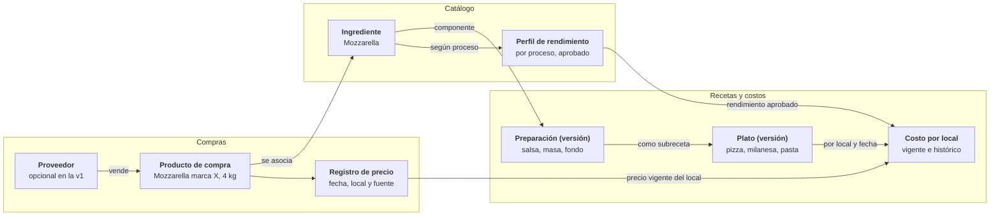

# Aplicación 1 — Recetario Digital Profesional · Prompt de desarrollo v2 (Grupo LF)

19 oct 2026 · Soy (Luciano Lopez Fuente)

> **Nota de Claude Code:** el documento llegó pegado como texto plano (2026-10-28).
>
> - Las tablas se rearmaron a partir del texto, sin cambiar su contenido.
> - El diagrama de la sección 5 se pasó a Mermaid desde una captura del original (2026-10-29).
> - Falta la tabla de etapas de la sección 20. Sus etapas igual están en la sección 24. Si Soy tiene el original, se completa.

## 1. Cómo encaja este documento

El Recetario Digital es la primera aplicación del Sistema Operativo Gastronómico y corresponde a la Fase 2 de la hoja de ruta general. Se construye recién cuando la Fase 1 (identidad, permisos y auditoría) está cerrada y aprobada.

Orden de lectura para Claude Code: `docs/prompt-maestro.md` → `docs/fases/fase-1.md` → este documento, guardado como `docs/fases/fase-2-recetario.md`. Si algo choca, manda el Prompt Maestro y se pregunta a Joaco.

Qué mejora esta versión 2 respecto de la original:

| Tema               | Versión 1                                                             | Versión 2                                                                                         |
| ------------------ | --------------------------------------------------------------------- | ------------------------------------------------------------------------------------------------- |
| Fases              | Tenía sus propias fases 1 a 6, con fundaciones incluidas              | Las fundaciones ya son la Fase 1 general; el recetario se divide en 5 etapas internas (2.1 a 2.5) |
| Tablas             | Nombres sueltos, algunos duplicados con la Fase 1 (users, audit_logs) | Todo dentro de esquemas por tema y reutilizando core, org, audit y workflow                       |
| Producto comercial | Mencionado en el agente futuro                                        | Tabla propia desde el día uno, separada del ingrediente y del precio                              |
| Cantidades         | Bruto, neto y cocido como campos sueltos                              | Cada línea declara qué representa su cantidad; el motor convierte con reglas exactas              |
| Costeo             | Reglas generales                                                      | Algoritmo paso a paso, estados de confiabilidad, snapshots inmutables y cola de recálculo         |
| Subrecetas         | Política de publicación a definir                                     | Propuesta concreta para que Soy apruebe                                                           |
| Tiempos            | Lista de tiempos                                                      | Tiempo total por camino crítico de pasos con dependencias                                         |
| Pruebas            | 15 escenarios                                                         | 15 escenarios con valores exactos más 12 adicionales                                              |
| Estética           | "Limpio y elegante"                                                   | Sistema de diseño simple y pastel del Prompt Maestro                                              |
| Ejecución          | Un prompt final                                                       | Prompts por etapa, listos para pegar                                                              |

## 2. Misión, equipo y referencias

**Misión:** construir la fuente central de conocimiento gastronómico de Grupo LF. Un dato se carga bien una vez, se verifica, queda con trazabilidad y lo usan todos los sistemas autorizados. La calidad del dato vale más que la cantidad de funciones.

**Primer objetivo económico:** conocer con precisión el costo teórico de cada plato, en cada restaurante.

**Primer objetivo operativo:** estandarizar recetas, rendimientos, porciones y procedimientos.

Actuás como un equipo senior formado por: arquitecto de software, especialista en PostgreSQL, desarrollador full stack, chef ejecutivo con experiencia en producción a escala, controller gastronómico de food cost, especialista en ingeniería de menú, especialista en inocuidad y trazabilidad, diseñador UX/UI de apps operativas y especialista en integraciones y agentes de IA. Antes de decidir algo, cada rol revisa la decisión desde su mirada.

Referencias conceptuales (solo como estándar profesional, nunca copiar código, diseño ni textos protegidos):

| Referencia                                      | Qué tomamos                                                                                                                 |
| ----------------------------------------------- | --------------------------------------------------------------------------------------------------------------------------- |
| CALCMENU                                        | Fichas técnicas, subrecetas, rendimientos, mermas, escalado, versiones, alérgenos, multirrestaurante, importación de Excel  |
| Cornell University (Food & Beverage Management) | Standard recipe costing, control de rendimientos, food cost %, contribution margin, menu engineering                        |
| EHL Hospitality Business School                 | Estandarización operativa, control de materias primas, productividad, disciplina económica junto a la creatividad culinaria |

Cuando una regla de este documento choque con una práctica de esas referencias, se explica la diferencia y se pregunta antes de decidir.

## 3. Contexto multimarca y alcance de cada receta

Una sola base para todo el grupo, con cada dato identificado por grupo, marca y establecimiento. Nunca una base ni una copia de recetas por restaurante.

| Establecimiento                                | Marca   | Tipo                                                                     |
| ---------------------------------------------- | ------- | ------------------------------------------------------------------------ |
| RAGU Bodegón — Parque Leloir                   | RAGU    | Restaurante                                                              |
| Trattoria Padella — Parque Leloir              | Padella | Restaurante                                                              |
| Casa Nonnos — Parque Leloir                    | Nonnos  | Restaurante                                                              |
| Pariggi                                        | Pariggi | Unidad productiva (pastas y elaboraciones), proveedora interna o externa |
| Futuras sucursales, marcas y cocinas centrales | —       | Se agregan sin cambiar el modelo                                         |

**Ajuste a la Fase 1:** `org.restaurants` suma la columna `site_type` (restaurante, cocina central, unidad productiva). Así Pariggi y las cocinas centrales usan los mismos permisos, costos y auditoría que un restaurante.

Alcance de una receta (columna `scope_type` de `recipes.recipes`):

| Alcance                               | Quién la define                      | Quién la usa                             |
| ------------------------------------- | ------------------------------------ | ---------------------------------------- |
| Maestra del grupo                     | Dirección o chef ejecutivo del grupo | Cualquier establecimiento asignado       |
| De marca                              | Chef ejecutivo de la marca           | Los locales de la marca asignados        |
| De establecimiento                    | Jefe de cocina con aprobación        | Solo ese local                           |
| De cocina central o unidad productiva | Responsable de producción            | Quien recibe esa elaboración             |
| Variante local autorizada             | Chef ejecutivo                       | Un local, a partir de una receta maestra |

**Principio clave:** la composición y el procedimiento se definen una vez; el costo se calcula en el contexto de cada establecimiento. Una misma bolognesa cuesta distinto en RAGU y en Padella si sus precios de compra son distintos, sin duplicar la ficha.

## 4. Qué entra en la versión 1

La versión 1 tiene que servir de verdad para cargar recetas y obtener costos teóricos confiables por plato y por establecimiento. Nada más, pero todo eso completo.

| Entra                                                             | No entra todavía                                        |
| ----------------------------------------------------------------- | ------------------------------------------------------- |
| Catálogo de materias primas, categorías, alias y unidades         | ERP, facturación o contabilidad                         |
| Productos de compra y precios manuales con historial              | Lectura automática de facturas (agente futuro)          |
| Rendimientos por proceso, ensayos y aprobación                    | Inventarios, stock y conteos                            |
| Recetas de preparación, subrecetas y platos                       | Órdenes y lotes de producción reales                    |
| Composición recursiva sin ciclos                                  | Costo real y desvíos (requiere producción e inventario) |
| Costo total, por kg, litro, unidad y porción, por establecimiento | Cartas, precios de venta e ingeniería de menú           |
| Propagación automática de cambios de precio                       | Costo de mano de obra en el plato                       |
| Tiempos por paso con camino crítico                               | Información nutricional calculada                       |
| Escalado sin tocar la versión aprobada                            | Agentes de IA modificando datos                         |
| Versiones, revisiones y aprobaciones                              |                                                         |
| Fotos, documentos y comentarios                                   |                                                         |
| Alérgenos con propagación y estado "no verificado"                |                                                         |
| Importación y exportación de Excel                                |                                                         |
| Fichas técnicas y de costeo en PDF                                |                                                         |
| Dashboard, calidad de datos y reportes                            |                                                         |

Lo que no entra igual queda previsto en el modelo (sección 19), para no reconstruir nada después.

## 5. Modelo conceptual: de la compra al plato

El costo de un plato se arma siempre por el mismo camino: lo que se compra, a qué ingrediente corresponde, cuánto rinde y en qué recetas se usa, calculado para cada local y fecha.

**Un ingrediente se carga una vez y su costo llega a cada plato por local.**



Varios productos de compra pueden apuntar al mismo ingrediente, y una preparación puede entrar en muchos platos. Por eso un aumento de precio llega solo a todos los platos afectados, en todos los niveles.

## 6. Conceptos que nunca se mezclan

Cada par de esta tabla vive en tablas o campos distintos. Confundirlos es la causa número uno de costos falsos.

| Concepto                      | No es lo mismo que              | Ejemplo                                                                |
| ----------------------------- | ------------------------------- | ---------------------------------------------------------------------- |
| Ingrediente gastronómico      | Producto de compra              | "Mozzarella" vs "Mozzarella marca X, horma de 4 kg"                    |
| Producto de compra            | Proveedor                       | La horma de 4 kg puede venderla más de un proveedor                    |
| Registro de precio            | Producto de compra              | Proveedor Y, 12/10/2026, $ 9.500 por kg                                |
| Receta                        | Versión de receta               | "Bolognesa" vs "Bolognesa v3, aprobada el 05/10/2026"                  |
| Receta                        | Lote producido                  | La fórmula vs los 25 kg que se hicieron hoy                            |
| Preparación o plato técnico   | Ítem de carta                   | "Ravioles con bolognesa" vs ese plato en la carta de salón a un precio |
| Peso de compra                | Peso limpio o cocido            | 2 kg de tomate comprado vs 1,5 kg de salsa terminada                   |
| Rendimiento estándar aprobado | Rendimiento medido en un ensayo | El 80 % oficial vs un 77 % medido el martes                            |
| Costo vigente                 | Costo histórico                 | El de hoy vs el guardado al 01/09/2026                                 |
| Costo teórico                 | Costo real                      | Lo que debería costar vs lo que costó (futuro)                         |
| Costo oficial                 | Costo simulado                  | Con precios vigentes vs "¿y si cambio de proveedor?"                   |
| Validez técnica de la receta  | Confiabilidad de su costo       | Receta aprobada con un precio pendiente                                |
| Dato medido                   | Dato estimado                   | Nunca se muestra una estimación como medición                          |

Todo dato numérico relevante lleva su fuente: manual, importado de Excel, medido en ensayo, informado por proveedor, calculado por el sistema, estimado o verificado por un responsable.

## 7. Base de datos: esquemas y tablas

El recetario agrega cinco esquemas y reutiliza los de la Fase 1. Todas las convenciones del Prompt Maestro valen: uuid, columnas de control, borrado lógico, RLS, auditoría por trigger y `comment on` en español.

Lo que ya existe y no se duplica:

| Nombre en la v1                                             | Se usa                                                                      |
| ----------------------------------------------------------- | --------------------------------------------------------------------------- |
| organizations, brands, establishments, production_locations | `org.groups`, `org.brands`, `org.restaurants` con `site_type`               |
| users, organization_memberships, user_roles                 | `core.user_profiles`, `core.user_memberships`, `core.user_role_assignments` |
| audit_logs                                                  | `audit.audit_events`                                                        |
| recipe_approvals, recipe_reviews                            | `workflow.approval_requests`, `workflow.approval_decisions`                 |

Tablas nuevas:

| Esquema       | Tablas                                                                                                                                                                                                       | Para qué                                                             |
| ------------- | ------------------------------------------------------------------------------------------------------------------------------------------------------------------------------------------------------------ | -------------------------------------------------------------------- |
| `catalog`     | ingredient_categories, ingredients, ingredient_aliases, units, unit_conversions, ingredient_unit_conversions, suppliers, purchase_products, allergens, ingredient_allergens                                  | Qué es cada cosa y cómo se mide                                      |
| `catalog`     | yield_processes, ingredient_yield_profiles, ingredient_yield_tests                                                                                                                                           | Rendimientos por proceso y sus ensayos                               |
| `costing`     | price_records, tax_policies, price_selection_policies, recipe_cost_current, recipe_cost_snapshots, recipe_cost_snapshot_lines, cost_recalc_queue, cost_scenarios                                             | Precios, cálculo vigente, historia inmutable y simulaciones          |
| `recipes`     | recipe_categories, recipes, recipe_versions, recipe_components, recipe_steps, recipe_step_dependencies, recipe_yield_tests, recipe_assignments, recipe_tags, recipe_tag_links, recipe_media, recipe_comments | Fichas técnicas, versiones y asignación a locales                    |
| `imports`     | import_jobs, import_column_mappings, import_staging_rows, import_errors                                                                                                                                      | Carga de Excel con validación y conciliación                         |
| `integration` | integration_outbox                                                                                                                                                                                           | Eventos de cambio para futuros agentes (los demás, en fases futuras) |

Reglas que la base hace cumplir:

- `recipe_components` tiene exactamente uno de `ingredient_id` o `sub_recipe_id` (check).
- `price_records`, `ingredient_yield_tests`, `recipe_cost_snapshots` y sus líneas son solo inserción.
- Una `recipe_version` publicada no admite update de su composición (trigger).
- No se borra un ingrediente, producto o receta usada en alguna versión histórica: solo se desactiva.
- Códigos únicos por grupo (`ingredients.code`, `recipes.code`) para importar sin duplicar.
- `jsonb` solo para metadatos variables y filas de importación; las relaciones son siempre columnas con claves foráneas.

Claude Code entrega el diccionario completo (campos, tipos, claves, restricciones, índices, regla de borrado, auditoría y alcance de acceso por tabla) en `docs/modulos/02-recetario-diccionario.md`, generado desde la base.

## 8. Unidades y conversiones

Todo cálculo interno se hace en tres unidades base: gramo para masa, mililitro para volumen y unidad para conteo. Lo que el usuario ve puede estar en kg, litros, docenas o cajas, pero el motor siempre convierte a base primero.

| Tipo de conversión                | Dónde vive                            | Ejemplo                              | Regla                                         |
| --------------------------------- | ------------------------------------- | ------------------------------------ | --------------------------------------------- |
| Universal dentro de una dimensión | `catalog.unit_conversions`            | 1 kg = 1.000 g; 1 l = 1.000 ml       | Fija, cargada una vez                         |
| Presentación comercial            | `catalog.purchase_products`           | Bolsa = 25.000 g; caja = 12 × 750 ml | Obligatoria en cada producto de compra        |
| Volumen ↔ masa                    | `catalog.ingredient_unit_conversions` | Aceite: densidad medida en g/ml      | Exige densidad del ingrediente, con fuente    |
| Unidad ↔ masa                     | `catalog.ingredient_unit_conversions` | 1 huevo, 1 atado de perejil          | Exige equivalencia medida, con fuente y fecha |

Reglas:

- Nunca se asume que 1 litro pesa 1 kilogramo, ni que una caja o un atado tiene un contenido fijo sin dato cargado.
- Si falta una conversión necesaria, la línea queda en estado CONVERSIÓN FALTANTE y la receta en costo incompleto. Nunca se adivina.
- Cada ingrediente define su unidad de compra, de uso en recetas, de almacenamiento y de costeo. Pueden ser distintas.
- Las unidades de pantalla siguen el uso argentino: kg, g, l, ml, unidad, docena, paquete, caja, bolsa, botella, lata, atado.
- Formato numérico es-AR: 1.234,56. Moneda: $ 1.234,56. Fecha: DD/MM/AAAA.

## 9. Rendimientos, mermas e hidratación

El rendimiento depende del proceso, no solo del ingrediente. Cada ingrediente tiene un perfil de rendimiento por proceso (papa pelada, carne desgrasada, pollo deshuesado, pasta hervida), y el motor usa siempre el estándar aprobado de ese perfil.

Dos factores separados:

**Rendimiento de limpieza** (siempre entre 0 y 1):

$$R_{limpieza} = \frac{P_{comestible}}{P_{bruto}} \qquad M_{limpieza} = 1 - R_{limpieza}$$

**Factor de cocción** (menor a 1 si pierde peso, mayor a 1 si gana por hidratación):

$$F_{coccion} = \frac{P_{despues}}{P_{antes}}$$

Si el factor es menor a 1 se muestra como merma de cocción (1 menos el factor). Si es mayor a 1 se muestra como factor de expansión (pastas, arroces, legumbres). Nunca se muestra una hidratación como "merma negativa".

Cantidad de compra necesaria para una cantidad de uso, según qué representa la cantidad de la línea:

$$Q_{compra} = \frac{Q_{uso}}{R_{limpieza}} \;(\text{si es peso limpio}) \qquad Q_{compra} = \frac{Q_{uso}}{R_{limpieza} \cdot F_{coccion}} \;(\text{si es peso cocido})$$

**Perfil de rendimiento** (`catalog.ingredient_yield_profiles`): ingrediente, proceso, corte o presentación, proveedor opcional, rendimiento de limpieza, factor de cocción, método, estado (borrador, aprobado, reemplazado), quién lo aprobó y cuándo.

**Ensayo** (`catalog.ingredient_yield_tests`): perfil, fecha, responsable, cantidad de muestras, pesos bruto, limpio, antes y después de cocción, descarte, observaciones y fotos.

Reglas:

- Un ensayo nuevo nunca cambia el estándar solo. El sistema muestra el estándar, el promedio de ensayos y la diferencia, y el chef propone un cambio que pasa por aprobación.
- Si un ingrediente no tiene perfil para el proceso usado, la línea queda como RENDIMIENTO NO DEFINIDO. Se puede usar 100 % solo si alguien lo declara explícitamente como "sin merma" con su firma.
- No existe un rendimiento universal por ingrediente.
- Los rendimientos se guardan con 4 decimales (`numeric(7,4)`) y se muestran como porcentaje con 1 decimal.

## 10. Precios, impuestos y política de costo

Un precio nunca se sobrescribe: cada cambio es un registro nuevo en `costing.price_records`, y el motor elige cuál usar según una política explícita por establecimiento.

Cada registro de precio guarda: producto de compra, proveedor opcional, alcance (grupo, marca o establecimiento), fecha del precio, vigencia desde y hasta, cantidad cotizada, unidad, precio, moneda (ARS al inicio), alícuota de IVA, descuentos, cargos adicionales (flete, otros), costo unitario neto normalizado a unidad base, fuente, usuario y observaciones.

**Cómo se elige el precio vigente** (política inicial, configurable en `costing.price_selection_policies`):

1. Precio manual vigente del establecimiento a la fecha de cálculo.
2. Si no hay, precio vigente de su marca.
3. Si no hay, precio vigente del grupo.
4. Si no hay ninguno: COSTO INCOMPLETO — FALTA PRECIO. Nunca cero.

Cada costo calculado guarda qué nivel usó, así se ve si un local está costeando con precio propio o heredado. Quedan previstos, sin activar, los métodos "último costo de compra" y "promedio ponderado".

**Impuestos** (`costing.tax_policies`, por sociedad o establecimiento):

- El costo se calcula neto de impuestos recuperables cuando la sociedad computa crédito fiscal (por ejemplo, el IVA para un responsable inscripto).
- Los impuestos no recuperables, fletes y otros cargos atribuibles se suman según lo que se configure.
- La política la define Soy con su contador; el sistema no asume nada por defecto.

**Moneda:** todo en ARS. La estructura admite otras monedas, pero nunca convierte sin una cotización cargada con fecha y fuente.

Para cada ingrediente se puede consultar: último precio válido, precio anterior, variación %, fecha, proveedor, costo por kg / l / unidad, rendimiento aplicado y costo por unidad comestible.

**Precios viejos:** un precio con más de 30 días sin actualizar se marca como desactualizado en pastel amarillo. El plazo es configurable por categoría.

## 11. Recetas, subrecetas y variantes

Un solo modelo de receta sirve para todo: preparaciones, subrecetas y platos terminados. Cualquier receta aprobada puede ser componente de otra, en tantos niveles como haga falta.

| Tipo (`recipe_type`) | Ejemplos                                                            | Unidad final típica |
| -------------------- | ------------------------------------------------------------------- | ------------------- |
| Preparación          | Salsa bolognesa, fileto, masa de pizza, puré, caldo, carne braseada | kg o litro          |
| Plato terminado      | Ravioles con bolognesa, milanesa napolitana, pizza de mozzarella    | porción             |
| Componente unitario  | Medallón, bollo, empanada armada                                    | unidad              |

Cada línea de componente (`recipes.recipe_components`) declara:

- Qué es: un ingrediente o una subreceta, nunca ambos.
- Cantidad y unidad.
- Base de la cantidad: peso de compra, peso limpio, peso cocido (para ingredientes) o cantidad terminada (para subrecetas).
- Perfil de rendimiento a aplicar, si es un ingrediente.
- Orden, observaciones y marca de "no escalar".

Con eso el motor sabe exactamente qué representa cada número y nunca aplica dos veces la misma merma: una subreceta entra por su costo por unidad terminada, que ya incluye sus propias mermas.

**Sin ciclos:** antes de guardar un componente, una función recorre el árbol con una consulta recursiva y rechaza la línea si la receta terminaría usándose a sí misma (A usa B, B usa C, C usa A). Profundidad máxima: 10 niveles.

**Subrecetas y versiones** (propuesta para que Soy apruebe):

- Cada plato publicado queda atado a la versión exacta de cada subreceta que usó.
- Cuando se publica una versión nueva de una subreceta, el sistema lista todos los platos afectados con su impacto de costo y crea una propuesta de actualización para cada uno.
- El chef ejecutivo aprueba esas propuestas en lote o una por una. Nada cambia en silencio.
- Los cambios de precio sí se reflejan solos en el costo vigente, porque no alteran la receta.

**Asignación a establecimientos** (`recipes.recipe_assignments`): qué receta usa cada local y desde cuándo. Una receta maestra se asigna a muchos locales sin copiarse.

**Variante local:** una receta propia con `variant_of_recipe_id` apuntando a la maestra. Solo la crea el chef ejecutivo, y el sistema muestra siempre las diferencias contra la maestra.

## 12. Motor de costeo

El cálculo vive en la base de datos, en funciones SQL deterministas, nunca en el navegador ni en un agente de IA. La misma receta, el mismo establecimiento y la misma fecha dan siempre el mismo resultado.

**Función central:** `costing.calculate_recipe_cost(recipe_version_id, restaurant_id, as_of_date)`. Devuelve el costo total, los costos unitarios, el detalle por línea y el estado de confiabilidad.

Algoritmo, línea por línea:

1. Convertir la cantidad de la línea a unidad base (g, ml o unidad). Si falta una conversión: línea incompleta.
2. Si es ingrediente: pasar a cantidad de compra con el perfil de rendimiento (sección 9); elegir el precio vigente con la política (sección 10); multiplicar.
3. Si es subreceta: calcular su costo por unidad terminada (llamada recursiva, con la versión atada) y multiplicar por la cantidad.
4. Heredar el peor estado de sus componentes.

Fórmulas:

$$C_{linea} = Q_{compra} \cdot P_{base} \qquad C_{receta} = \sum C_{lineas}$$

$$C_{por\,kg} = \frac{C_{receta}}{R_{final}} \qquad C_{porcion} = \frac{C_{receta}}{N_{porciones}} \qquad Part_{i} = \frac{C_{i}}{C_{receta}} \cdot 100$$

Donde el rendimiento final es el medido y aprobado si existe, o el teórico marcado como estimado. Si el rendimiento o las porciones son cero o faltan, no se divide: el costo unitario queda incompleto.

Ejemplo de control (del documento original, verificado):

| Paso                            | Valor                   |
| ------------------------------- | ----------------------- |
| 2 kg de tomate a $ 3.000 por kg | $ 6.000                 |
| Salsa terminada                 | 1,5 kg                  |
| Costo por kg de salsa           | $ 6.000 / 1,5 = $ 4.000 |
| Plato que usa 150 g de salsa    | $ 600                   |

El plato toma la salsa a $ 4.000 por kg terminado; la merma del tomate ya está adentro y no se vuelve a aplicar.

**Estados de confiabilidad del costo:**

| Estado                    | Cuándo                                                       | Color          |
| ------------------------- | ------------------------------------------------------------ | -------------- |
| Completo y verificado     | Todos los precios vigentes, rendimientos aprobados y medidos | Verde menta    |
| Completo con estimaciones | Algún rendimiento teórico o precio heredado de marca o grupo | Amarillo crema |
| Incompleto                | Falta precio, conversión o rendimiento en alguna línea       | Rosa suave     |
| Desactualizado            | Algún precio supera el plazo de vigencia                     | Durazno        |

**Precisión:** cantidades `numeric(18,6)`, importes `numeric(18,4)`, rendimientos `numeric(7,4)`. Sin redondeo intermedio; se redondea solo al mostrar (2 decimales en pesos).

**Tres tipos de costo, siempre identificados:**

- **Vigente** (`costing.recipe_cost_current`): una fila por versión publicada y establecimiento, siempre al día.
- **Histórico** (`costing.recipe_cost_snapshots` + líneas): fotos inmutables con versión, componentes, cantidades, rendimientos, precios usados, nivel de precio, moneda, establecimiento, fecha y versión del método de cálculo. Se generan al publicar, al cambiar un precio, a fin de cada mes y a pedido.
- **Simulado** (`costing.cost_scenarios`): cambia proveedor, gramaje, rendimiento o precio en un escenario aparte. Nunca toca los oficiales.

**Propagación de un cambio de precio:**

1. Se inserta el precio nuevo (el anterior queda intacto).
2. Un trigger busca en el árbol de dependencias todas las recetas afectadas, en todos los niveles, y las pone en `costing.cost_recalc_queue`.
3. Una función procesa la cola en orden de abajo hacia arriba (primero subrecetas, después platos), actualiza el costo vigente y crea los snapshots.
4. Se emite un evento en `integration.integration_outbox` y se arma el reporte: costo anterior, actual, diferencia en $ y %, fecha y locales afectados.

Ejemplo: sube 12 % la mozzarella → el sistema lista las pizzas, las milanesas napolitanas, las pastas gratinadas y las preparaciones intermedias con mozzarella, con su impacto en cada local.

## 13. Ficha técnica, tiempos y escalado

La ficha técnica es la versión de receta vista completa. Cada bloque vive en su tabla y se carga por pestañas, nunca en un formulario interminable.

| Bloque         | Contenido                                                                                                                                                                                                      |
| -------------- | -------------------------------------------------------------------------------------------------------------------------------------------------------------------------------------------------------------- |
| Identificación | Código, nombre, nombre corto, descripción gastronómica, marca, alcance, tipo, categoría, subcategoría, sector, partida, estado, versión, autor, responsable técnico, fechas de creación, revisión y aprobación |
| Composición    | Líneas de la sección 11 con costo normalizado, costo usado, costo parcial y participación % (visibles solo con permiso de costos)                                                                              |
| Rendimiento    | Cantidad inicial, rendimiento teórico, rendimiento medido aprobado, peso o volumen final, porciones, peso por porción, merma total, unidad final                                                               |
| Procedimiento  | Preparación previa, pasos ordenados con tiempo, temperatura de proceso, equipo, técnica, puntos de control, errores frecuentes y criterio de calidad                                                           |
| Conservación   | Método, temperatura y vida útil solo desde procedimientos validados, regeneración, enfriamiento, condiciones de descarte                                                                                       |
| Presentación   | Fotos de producto, emplatado y puntos críticos, montaje, vajilla, peso servido, guarnición, terminación, temperatura de servicio validada                                                                      |
| Adicional      | Alérgenos, etiquetas, documentos, observaciones, historial                                                                                                                                                     |

**Tiempos por paso** (`recipes.recipe_steps` + `recipe_step_dependencies`): cada paso registra tiempo activo, pasivo, cocción, reposo, fermentación, enfriamiento, regeneración o emplatado, operarios, sector, equipo y su capacidad, tamaño de lote, tiempo estimado y tiempo medido.

El tiempo total no es la suma de los pasos: es el camino crítico entre pasos que dependen unos de otros. Ejemplo: A (20 min) habilita B (60 min) y C (30 min) en paralelo; D (10 min) espera a B y C. Total = 20 + 60 + 10 = 90 min, no 120.

Los minutos activos sí se suman y alimentan, a futuro, kg por hora, porciones por hora y horas-hombre por lote.

**Escalado:**

$$factor = \frac{objetivo}{rendimiento\;base} \qquad Q_{nueva} = Q_{original} \cdot factor$$

- Se escala por porciones, kg, litros o unidades. La pantalla muestra cantidades originales, factor, nuevas cantidades, costo proyectado, equipo necesario y advertencias.
- Las líneas marcadas "no escalar" (terminaciones, redondeos operativos) se muestran aparte para ajuste manual.
- Los tiempos no se escalan linealmente: si el lote supera la capacidad del equipo, aparece una advertencia de "más tandas".
- Escalar nunca modifica la versión aprobada. Solo se guarda como plan de producción o como versión nueva si alguien lo decide expresamente.

## 14. Versiones, aprobaciones, fotos y alérgenos

Una versión publicada nunca se edita. Cualquier cambio a una receta aprobada crea una versión nueva en borrador, que recorre el motor de aprobaciones de la Fase 1 (`workflow`).

**Estados de versión:** borrador → en revisión → aprobada → publicada (vigente) → reemplazada → archivada. La cocina ve siempre la vigente; el responsable técnico ve todas.

Cada versión nueva registra: versión anterior, qué cambió (diferencias línea por línea), por qué, quién lo pidió, quién aprobó, fecha, locales afectados, impacto económico por local y notas de degustación o producción.

Cada tipo de cambio tiene su camino:

| Cambio                               | Camino                                               | Crea versión de receta         |
| ------------------------------------ | ---------------------------------------------------- | ------------------------------ |
| Composición, gramaje o procedimiento | Aprobación del chef ejecutivo                        | Sí                             |
| Precio de materia prima              | Carga de Compras o Costos, aprobación según política | No, recalcula el costo         |
| Rendimiento estándar                 | Ensayo + aprobación del chef                         | No, recalcula y avisa          |
| Proveedor o producto de compra       | Compras, con aprobación del controller               | No                             |
| Presentación o fotos                 | Jefe de cocina, revisión del chef                    | Solo si cambia el peso servido |

**Fotos y documentos:** se guardan en Supabase Storage en carpetas por establecimiento y receta, con permisos iguales a los de la receta. En la base quedan id, receta, versión, tipo (producto final, emplatado, materia prima, paso, punto crítico, ejemplo correcto, ejemplo incorrecto), usuario, fecha y descripción. Las imágenes se comprimen y se generan miniaturas para el celular.

**Comentarios:** técnicos, de revisión, de cocina o pedidos de cambio, con autor y fecha. Un comentario nunca modifica la receta; a lo sumo abre un pedido de cambio.

**Alérgenos:**

- Lista inicial configurable según el Código Alimentario Argentino, validada por un responsable antes de usarse.
- Cada ingrediente tiene, por alérgeno, uno de cuatro estados: contiene, puede contener (trazas), no contiene verificado, sin dato.
- Se propagan solos por subrecetas hasta el plato. Si un componente está sin dato, el plato muestra NO VERIFICADO. Nunca "sin alérgenos" por falta de datos.

**Inocuidad:** temperaturas seguras, vidas útiles y vencimientos solo se cargan desde procedimientos aprobados y normativa aplicable, con referencia al documento. El sistema nunca los propone ni los inventa. Queda previsto el modelo para nutrientes, lotes, trazabilidad y etiquetado.

## 15. Importación desde Excel

Excel es una puerta de entrada y de salida, nunca la fuente de verdad. Nada importado llega a las tablas oficiales sin pasar por validación, vista previa y confirmación.

Plantilla oficial descargable (XLSX, también CSV), con una hoja por tema y una hoja de instrucciones con ejemplos ficticios:

| Hoja                | Clave para no duplicar                                   |
| ------------------- | -------------------------------------------------------- |
| INGREDIENTES        | Código de ingrediente                                    |
| PRODUCTOS_DE_COMPRA | Código de producto o proveedor + descripción + contenido |
| PRECIOS             | Producto + alcance + fecha de vigencia                   |
| RENDIMIENTOS        | Ingrediente + proceso                                    |
| RECETAS             | Código de receta                                         |
| COMPONENTES         | Código de receta + orden de línea                        |
| PASOS               | Código de receta + número de paso                        |
| ASIGNACIONES        | Código de receta + código de establecimiento             |

Flujo obligatorio:

1. Subir el archivo; se guarda en Storage con su huella digital (SHA-256).
2. Leer la estructura y detectar columnas.
3. Mapear columnas (se recuerda el mapeo para la próxima vez).
4. Cargar todo a `imports.import_staging_rows`, sin tocar tablas oficiales.
5. Validar fila por fila: duplicados, ingredientes inexistentes, unidades ambiguas o incompatibles, cantidades inválidas, precios faltantes, ciclos de subrecetas.
6. Proponer coincidencias con ingredientes existentes por similitud de nombre y alias (`pg_trgm`), para que una persona confirme.
7. Mostrar vista previa: qué se crea, qué se actualiza, qué se ignora y qué tiene error.
8. Pedir confirmación con permiso `imports.approve`.
9. Importar en una sola transacción por bloque; si algo falla, no queda nada a medias.
10. Guardar el resultado: creados, actualizados, omitidos, errores por fila, usuario y fecha.

**Idempotencia:** el mismo archivo subido dos veces se reconoce por su huella y no se reimporta; un archivo distinto con los mismos códigos actualiza en lugar de duplicar, y muestra las diferencias antes.

**Lo que la importación nunca hace:** crear duplicados en silencio, inventar rendimientos, asumir unidades ambiguas, publicar recetas (todo entra como borrador) ni ocultar errores. Las filas con error se pueden descargar, corregir y volver a subir.

**Exportación:** catálogos, precios, rendimientos, recetas y costos a Excel y CSV, con la fecha de los datos y el usuario que exportó.

## 16. Calidad de datos

Cada receta se mide en dos ejes que no se mezclan: si está lista para cocinar y si su costo es confiable. Una receta puede estar aprobada para producción y tener a la vez un precio pendiente.

| Eje                     | Estados                                                                         |
| ----------------------- | ------------------------------------------------------------------------------- |
| Validez técnica         | Borrador · Pendiente de revisión · Aprobada para producción                     |
| Confiabilidad del costo | Completo y verificado · Completo con estimaciones · Incompleto · Desactualizado |

No se usa ningún índice inventado de "precisión": se cuentan hechos objetivos.

Indicadores (vista `reporting.v_data_quality`, por grupo, marca y establecimiento):

- Ingredientes con precio vigente, con unidad normalizada y con rendimiento aprobado (%).
- Recetas con costo completo y recetas aprobadas (%).
- Recetas sin foto, sin rendimiento o con componentes inactivos.
- Ingredientes posiblemente duplicados (nombres o alias muy parecidos).
- Precios desactualizados.
- Recetas pendientes de revisión y propuestas de actualización de subrecetas sin decidir.

Cada indicador abre la lista exacta de registros a corregir, con un botón para ir directo a cada uno.

## 17. Permisos

El recetario usa los roles y la función `core.has_permission()` de la Fase 1. Solo agrega permisos nuevos al catálogo; no crea un sistema propio.

**Permisos nuevos:** `catalog.view`, `catalog.manage`, `prices.view`, `prices.propose`, `prices.approve`, `yields.record`, `yields.approve`, `recipes.view`, `recipes.view_costs`, `recipes.draft`, `recipes.review`, `recipes.approve`, `recipes.publish`, `recipes.archive`, `recipes.assign`, `scenarios.manage`, `imports.run`, `imports.approve`, `reports.export`.

| Rol                 | Permisos principales                                                                | Nunca                               |
| ------------------- | ----------------------------------------------------------------------------------- | ----------------------------------- |
| Superadministrador  | Configuración técnica                                                               | Cambiar recetas o precios sin flujo |
| Dirección General   | Ver todo con costos, aprobar cambios críticos, exportar                             | —                                   |
| Director de Marca   | Ver recetas y costos de su marca, aprobar dentro de la marca                        | Ver otras marcas sin permiso        |
| Chef Ejecutivo      | Borrador, revisión, aprobación, publicación, asignación, rendimientos               | Aprobar precios                     |
| Jefe de Cocina      | Borrador, pedir revisión, registrar ensayos de rendimiento, ver recetas de su local | Publicar sin aprobación             |
| Controller / Costos | Ver costos, aprobar precios, escenarios, reportes                                   | Cambiar gramajes o procedimientos   |
| Compras             | Catálogo, productos de compra, proponer precios, importar                           | Aprobar sus propios precios         |
| Cocinero / Operador | Ver la vista de cocina de las recetas vigentes de su local                          | Ver precios o costos                |
| Auditor / Consulta  | Leer historial y reportes autorizados                                               | Crear, editar o aprobar             |

**Costos protegidos de verdad:** quien no tiene `recipes.view_costs` lee las recetas desde una vista sin columnas económicas (`recipes.v_kitchen_card`), y las tablas `costing.*` le devuelven cero filas por RLS. Las fotos y documentos siguen los mismos permisos en Storage.

## 18. Pantallas, dashboard y reportes

Todo sigue el sistema de diseño del Prompt Maestro: fondo blanco cálido, tarjetas blancas, estados en pastel, Inter, mucho aire. Pensado para carga repetitiva en computadora y para consulta rápida en tablet y celular dentro de la cocina.

**Navegación principal:** Inicio · Materias primas · Recetas · Preparaciones · Costos · Importaciones · Revisiones · Reportes · Configuración. Arriba, siempre visible, el selector de grupo, marca y establecimiento.

| Pantalla                | Lo esencial                                                                                                                                                                                                          |
| ----------------------- | -------------------------------------------------------------------------------------------------------------------------------------------------------------------------------------------------------------------- |
| Lista de recetas        | Tabla con código, nombre, tipo, categoría, marca, local, versión, rendimiento, costo total, costo unitario, estado técnico, confiabilidad de costo y última actualización; búsqueda, filtros, orden y exportación    |
| Editor de receta        | Pestañas: General, Componentes, Procedimiento, Rendimiento, Tiempos, Costos, Fotos, Revisiones, Historial. Guarda borradores solo; al agregar una línea muestra su costo parcial y el total se actualiza al instante |
| Buscador de componentes | Escribir 3 letras y elegir ingrediente o subreceta por nombre, alias o código; muestra unidad y si tiene precio                                                                                                      |
| Ficha de materia prima  | Datos, productos de compra, historial de precios con gráfico simple, perfiles de rendimiento, ensayos, alérgenos, recetas donde se usa                                                                               |
| Vista de cocina         | Letra grande, sin precios: foto, rendimiento, ingredientes y cantidades, pasos, equipo, tiempos, puntos críticos, porcionado y presentación. Pensada para tablet en la mesada                                        |
| Escalado                | Objetivo, factor, cantidades nuevas, advertencias, imprimir                                                                                                                                                          |
| Impacto de precio       | Antes y después, por plato y por local, al cargar un precio nuevo                                                                                                                                                    |
| Importaciones           | Asistente paso a paso de la sección 15                                                                                                                                                                               |
| Revisiones              | Bandeja de aprobaciones con diferencias entre versiones                                                                                                                                                              |

**Dashboard inicial** (pregunta: "¿qué tan completo y confiable está nuestro recetario?"):

- Tarjetas: materias primas, recetas, preparaciones, recetas aprobadas, pendientes, con costo incompleto, ingredientes sin precio, precios desactualizados.
- Costos: recetas con mayor costo por porción, materias primas de mayor incidencia, recetas afectadas por cambios recientes de precio, componentes más usados, recetas pendientes de recálculo.
- Actividad: revisiones recientes, últimas importaciones, errores de calidad.
- Nada que dependa de integraciones futuras se muestra como real.

**Reportes** (PDF, Excel y CSV, con fecha de datos, versión y local):

| Reporte          | Contenido                                                             |
| ---------------- | --------------------------------------------------------------------- |
| Ficha técnica    | Ingredientes, cantidades, rendimientos, procedimiento, fotos, versión |
| Ficha de costeo  | Costo por línea, subrecetas, total, unitario, participación %, estado |
| Materias primas  | Nombre, categoría, unidad, precio normalizado, fecha                  |
| Rendimientos     | Ingrediente, proceso, rendimiento, merma, fecha de validación         |
| Dónde se usa     | Todos los platos que usan un ingrediente o preparación                |
| Cambios de costo | Anterior, actual, variación y platos impactados por período           |
| Calidad de datos | Registros incompletos y acción para completarlos                      |

## 19. Preparado para el futuro

Nada de esto se construye en la versión 1, pero el modelo lo deja posible sin reconstruir. La regla: identificadores estables, historia completa y conceptos separados desde hoy.

**Cartas y precios de venta** (módulo futuro): el ítem de carta es distinto de la receta técnica. Un plato puede tener varios tamaños, cartas, canales, precios, modificadores y combos sobre la misma receta base.

$$Food\,Cost\,\% = \frac{Costo\;te\acute{o}rico\;por\;porci\acute{o}n}{Precio\;de\;venta\;neto} \cdot 100 \qquad CM = Ingreso\;neto - Costos\;variables\;directos$$

- El margen de contribución nunca se llama utilidad neta; mano de obra y gastos generales van separados.
- La clasificación de ingeniería de menú (estrellas, caballos de batalla, rompecabezas, perros) usará popularidad y contribución por categoría y período, con ventas reales importadas. Nunca solo food cost ni ventas inventadas.

**Costo teórico contra costo real:** órdenes de producción, lotes, inventarios, consumos, mermas reales y ventas por plato van a usar los mismos ids de receta, versión, ingrediente y local. Sin registros reales suficientes, no se calcula costo real.

**Agente de facturas y compras:** leerá facturas y remitos, reconocerá productos de compra, los vinculará a ingredientes y propondrá precios nuevos. Por eso el producto de compra ya es una tabla aparte. El agente nunca crea un ingrediente nuevo por una descripción distinta; las coincidencias dudosas las confirma una persona.

**Consultas de agentes de IA:** vía funciones y vistas seguras de `reporting`, con su propia cuenta técnica y permisos. Cada respuesta debe poder indicar establecimiento, versión de receta, fecha del precio, fecha del cálculo, fuente, estado de confiabilidad y datos pendientes. Ejemplos que el modelo ya permite responder:

- ¿Cuánto cuesta producir 1 kg de bolognesa en Padella?
- ¿Qué platos usan mozzarella y cuánto subieron con el último aumento?
- ¿Qué platos de RAGU tienen costo incompleto?
- ¿Cómo cambió el costo de una receta en los últimos 6 meses?
- ¿Qué preparación consume más minutos activos por kg?

Ningún agente modifica recetas aprobadas, rendimientos estándar ni costos oficiales: solo propone, por el flujo de aprobación.

## 20. Etapas de construcción

La Fase 2 se construye en cinco etapas, en este orden. Las fundaciones (proyecto, GitHub, Vercel, Supabase, autenticación, permisos) ya quedaron hechas en las Fases 0 y 1.

> _(La tabla de etapas no llegó al pegar el documento. Las etapas 2.1 a 2.5 y su contenido están en la sección 24.)_

La última compuerta es la misma de la hoja de ruta general: con ella se cierra la Fase 2 y se habilita la Fase 3 (operación).

## 21. Pruebas

Veintisiete pruebas automatizadas con datos ficticios, todas en GitHub Actions. Ninguna se declara superada sin haberse ejecutado, y ninguna se debilita para que pase.

Las 15 del documento original, con valor exacto esperado:

| #   | Escenario              | Dato de entrada                                                 | Resultado esperado                                                   |
| --- | ---------------------- | --------------------------------------------------------------- | -------------------------------------------------------------------- |
| 1   | Conversión de unidades | $ 8.000 por kg, receta usa 120 g                                | $ 960,00                                                             |
| 2   | Merma                  | Rendimiento 80 %, se usan 800 g limpios, $ 5.000 por kg         | 1.000 g de compra, $ 5.000,00                                        |
| 3   | Subreceta              | Salsa a $ 4.000 por kg terminado, plato usa 150 g               | $ 600,00                                                             |
| 4   | Costo por porción      | Preparación de $ 12.000, 10 porciones                           | $ 1.200,00                                                           |
| 5   | Cambio de precio       | Sube un ingrediente usado en 3 niveles                          | Se recalculan todos los niveles; los snapshots anteriores no cambian |
| 6   | Versiones              | Se modifica una receta aprobada                                 | Nace v2 en borrador; v1 sigue vigente y consultable                  |
| 7   | Multiestablecimiento   | Misma bolognesa; carne a $ 10.000 en RAGU y $ 11.000 en Padella | Dos costos distintos, una sola receta                                |
| 8   | Importación repetida   | El mismo archivo dos veces                                      | Cero registros duplicados                                            |
| 9   | Dato faltante          | Un ingrediente sin precio                                       | Costo incompleto con aviso; nunca $ 0                                |
| 10  | Ciclo                  | A usa B, B usa C, se intenta que C use A                        | Rechazado con mensaje claro                                          |
| 11  | Permisos               | Usuario de un local edita receta de otro                        | Rechazado por la base y registrado                                   |
| 12  | Persistencia           | Crear receta, cerrar sesión, volver                             | Receta idéntica                                                      |
| 13  | Importación defectuosa | Unidades ambiguas, filas duplicadas, referencias inexistentes   | Errores por fila; ningún registro válido alterado                    |
| 14  | Escalado               | Escalar 10 kg a 25 kg                                           | Factor 2,5; la versión aprobada no cambia                            |
| 15  | Integridad histórica   | Varios cambios de precio y receta                               | Un snapshot viejo conserva todos sus valores                         |

Adicionales:

| #   | Escenario         | Dato de entrada                                                             | Resultado esperado                                            |
| --- | ----------------- | --------------------------------------------------------------------------- | ------------------------------------------------------------- |
| 16  | Densidad          | Aceite con densidad de prueba 0,92 g/ml, receta usa 100 ml, $ 10.000 por kg | 92 g, $ 920,00                                                |
| 17  | Densidad faltante | Receta en ml, ingrediente sin densidad                                      | Conversión faltante, costo incompleto                         |
| 18  | Hidratación       | Pasta con factor de prueba 2,5; plato usa 250 g cocida; $ 3.000 por kg seca | 100 g secos, $ 300,00                                         |
| 19  | Doble merma       | Plato usa salsa con merma de tomate incluida                                | La merma del tomate no se aplica de nuevo                     |
| 20  | Impuestos         | $ 12.100 por kg con 21 % de IVA recuperable                                 | $ 10.000,00 por kg neto                                       |
| 21  | Precio heredado   | Local sin precio propio, marca con precio                                   | Usa el de marca y marca "con estimaciones"                    |
| 22  | Camino crítico    | A 20 min → B 60 y C 30 en paralelo → D 10                                   | 90 min                                                        |
| 23  | Alérgenos         | Subreceta con un ingrediente sin dato                                       | Plato "no verificado"                                         |
| 24  | Vista de cocina   | Cocinero consulta una receta                                                | Sin ningún valor económico, ni en la respuesta de la API      |
| 25  | Rendimiento       | Se registra un ensayo distinto al estándar                                  | El estándar no cambia sin aprobación                          |
| 26  | Subreceta nueva   | Se publica v2 de una salsa                                                  | Los platos siguen con v1 y reciben propuesta de actualización |
| 27  | Rendimiento cero  | Receta con rendimiento 0                                                    | Sin división; costo unitario incompleto                       |

Los datos de demostración llevan el prefijo `DEMO-` en el código y una marca visible en pantalla. Nunca se mezclan con datos reales.

## 22. Decisiones para Soy

Ocho decisiones que Claude Code no puede tomar solo. Cada una tiene una propuesta; Soy confirma o cambia antes de empezar la etapa que la necesita.

| #   | Decisión                               | Propuesta                                                                                                                                   | Se necesita en |
| --- | -------------------------------------- | ------------------------------------------------------------------------------------------------------------------------------------------- | -------------- |
| 1   | Subrecetas nuevas en platos publicados | Atar versión y aprobar actualizaciones en lote (sección 11)                                                                                 | Etapa 2.2      |
| 2   | Orden de precios por local             | Local → marca → grupo, marcando lo heredado                                                                                                 | Etapa 2.1      |
| 3   | IVA y otros impuestos                  | Neto de lo recuperable por sociedad; Soy confirma con su contador                                                                           | Etapa 2.1      |
| 4   | Quién aprueba precios                  | Compras propone, Controller aprueba; aumentos grandes con Dirección                                                                         | Etapa 2.1      |
| 5   | Rendimiento que usa el motor           | Siempre el estándar aprobado, nunca la última medición                                                                                      | Etapa 2.1      |
| 6   | Pariggi como proveedor interno         | Sus elaboraciones entran como producto de compra con precio de transferencia, o como receta de cocina central con su costo real; elegir una | Etapa 2.2      |
| 7   | Plazo de precio desactualizado         | 30 días general, ajustable por categoría                                                                                                    | Etapa 2.1      |
| 8   | Primeras 20 recetas reales             | Lista de platos que el Controller valida en la compuerta de la Fase 2                                                                       | Etapa 2.5      |

## 23. Reglas innegociables y criterio de éxito

**Orden de construcción obligatorio:** base de datos → reglas de negocio → motor de cálculo → interfaz → reportes → integraciones. Nunca un dashboard lindo con datos ficticios antes de que el motor funcione.

Reglas:

1. La base de datos es el activo principal del proyecto.
2. No duplicar información sin necesidad.
3. No perder información histórica.
4. Un precio faltante nunca vale cero.
5. No inventar rendimientos, temperaturas, vidas útiles, recetas ni costos oficiales.
6. No mezclar establecimientos.
7. No confundir costo teórico, real, histórico y simulado.
8. No modificar recetas aprobadas sin versión nueva.
9. No permitir subrecetas circulares.
10. No exponer datos económicos sin permiso.
11. Excel no es fuente permanente de información.
12. Los cálculos fundamentales no dependen de agentes de IA.
13. No ocultar errores de importación.
14. Ninguna función nueva rompe datos existentes.
15. Un módulo sin pruebas superadas no está terminado.
16. La integridad del dato va antes que la velocidad visual.
17. Cada módulo se puede usar desde otros sistemas por integraciones seguras.
18. Las decisiones culinarias, contables o sanitarias se consultan a una persona competente.

El recetario es un éxito cuando Grupo LF puede: registrar una materia prima una sola vez, actualizar su precio, conocer su rendimiento real, usarla en muchas preparaciones y platos, calcular costos automáticamente por local, compararlos, conservar la historia, imprimir fichas profesionales, incorporar recetas desde Excel, detectar lo incompleto y entregar datos confiables a los próximos agentes.

Cada receta es conocimiento. Cada ingrediente es un dato. Cada rendimiento es una medición. Cada costo es una decisión. Y toda esa información debe alimentar una empresa gastronómica inteligente.

## 24. Prompts para pegar en Claude Code

Joaco guarda este documento como `docs/fases/fase-2-recetario.md` y trabaja una etapa por vez, en modo plan, con una o más sesiones por etapa.

**Prompt de arranque de la Fase 2 (una sola vez):**

```text
Leé completos docs/prompt-maestro.md, docs/fases/fase-1.md,
docs/fases/fase-2-recetario.md y docs/estado.md.

Antes de escribir código, presentá:
1. La arquitectura del recetario y cómo se apoya en la Fase 1.
2. El diagrama de entidades y relaciones (Mermaid) de los esquemas
   catalog, costing, recipes, imports e integration.
3. El diccionario inicial de datos.
4. Las reglas exactas de cálculo, con los 27 casos de prueba.
5. Las pantallas de la versión 1.
6. El orden de construcción por etapas 2.1 a 2.5.
7. Las decisiones de la sección 22 que todavía no están confirmadas.

No inventes recetas, rendimientos, temperaturas ni costos reales.
Usá solo datos DEMO- para desarrollo. Calidad antes que velocidad.
Cuando apruebe, empezá por la etapa 2.1.
```

**Prompt de apertura de cada sesión:**

```text
Leé docs/estado.md y la etapa actual en docs/fases/fase-2-recetario.md.
Decime qué quedó hecho y qué falta, y proponé el plan de esta sesión:
migraciones, funciones, políticas RLS, pantallas, pruebas y riesgos.
No escribas código hasta que apruebe el plan.
```

| Etapa                         | Prompt                                                                                                                                                                                                                                                                                                      |
| ----------------------------- | ----------------------------------------------------------------------------------------------------------------------------------------------------------------------------------------------------------------------------------------------------------------------------------------------------------- |
| 2.1 Materias primas y precios | "Construí el esquema catalog y las tablas de precios de costing según las secciones 7 a 10: unidades, conversiones, proveedores, productos de compra, precios, política de selección, impuestos, perfiles y ensayos de rendimiento. Pantalla de ficha de materia prima. Pruebas 1, 2, 16, 17, 20, 21 y 25." |
| 2.2 Recetas                   | "Construí el esquema recipes según las secciones 11, 13 y 14: recetas, versiones, componentes con base de cantidad, bloqueo de ciclos, pasos con dependencias, asignaciones, variantes, fotos, comentarios y alérgenos. Editor de receta y vista de cocina. Pruebas 6, 10, 11, 12, 22, 23, 24 y 26."        |
| 2.3 Motor de costos           | "Construí el motor de la sección 12: calculate_recipe_cost, costo vigente, snapshots, cola de recálculo, escenarios simulados y escalado. Pantallas de costos, impacto de precio y escalado. Pruebas 3, 4, 5, 7, 9, 14, 15, 18, 19 y 27."                                                                   |
| 2.4 Excel                     | "Construí el esquema imports y el asistente de la sección 15, con plantilla oficial, staging, validación, coincidencias, vista previa, importación transaccional y exportación. Pruebas 8 y 13."                                                                                                            |
| 2.5 Control y reportes        | "Construí calidad de datos (sección 16), dashboard y reportes en PDF, Excel y CSV (sección 18). Corré las 27 pruebas, pedí revisión a los 4 subagentes y prepará el informe de cierre para Soy."                                                                                                            |

Al cerrar cada sesión: actualizar `docs/estado.md`, abrir un pull request con resumen en simple, capturas y pruebas ejecutadas, y esperar la aprobación de Joaco.
