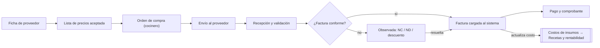
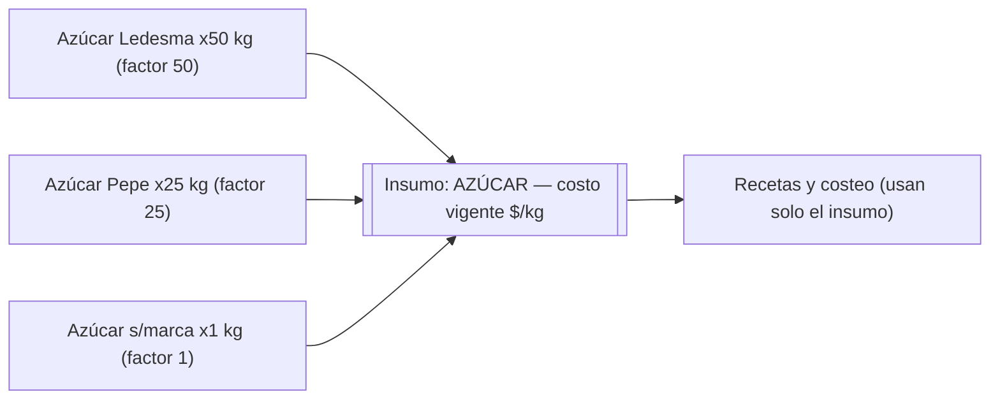

# Módulo 2 «Facturas»: administración y compras (documento de Soy, 2026-11-14)

> Este es el documento que escribió Soy para el módulo de Administración y Facturas. Se guarda completo y tal como llegó, igual que `fase-2-recetario.md`. Soy lo llama **Módulo 2: Facturas**; en la hoja de ruta del prompt maestro es la **Fase 3 (compras)**. Cómo se construye, en qué orden y qué se reutiliza está en `docs/prompts/2026-11-14-facturas-modulo-2.md`. Si este documento y los prompts no coinciden, mandan los prompts, porque ya tienen en cuenta lo que existe en la base.

---

# Administración y Facturas — Módulo de Compras

Restaurante 100% Digital · Grupo LF · Especificación funcional y técnica · 14-nov-2026

## Resumen y alcance

El módulo **Administración y Facturas** cierra el circuito completo de compras —proveedor → orden de compra → recepción → factura → pago— y es la **única fuente de costos de materia prima** para todo el sistema (Recetario, Rentabilidad, tableros). En el árbol de desarrollos es la pata de **Rentabilidad**, junto al módulo de Costos y Recetas ya en proceso.

Principios:

- Todo queda registrado en base de datos (Supabase): costos, órdenes de compra, facturas, recepciones y adjuntos.
- La nomenclatura de los productos en la orden de compra es la misma que la de la factura de cada proveedor.
- La última lista de precios **aceptada por administración** es la vigente; sin ella, la factura queda en duda.
- Toma pantallas, colores y morfología del sistema maestro (flat, pasteles, tilde verde / X roja, menú lateral).
- Referencia conceptual: circuito de compras de Odoo (OC → recepción → factura → pago, con control de 3 vías), en versión simple y sintética.

Integración: la base de datos toma todas las referencias del módulo Costos y Recetas y de los datos ya existentes del sistema general — un solo catálogo de insumos / materias primas para todo. Este módulo solo agrega los artículos de proveedor y su mapeo.

## Flujo completo del circuito

Sin lista de precios vigente aceptada, la factura no pasa el control: queda observada y salta la alarma en el tablero. Recién cuando queda conforme se libera el pago y se actualizan los costos.

## Etapa 0 — Alta y ficha de proveedor

El alta la hace administración, todo en casillas (dropdowns, tildes y campos cortos) según el sistema maestro. Desde la ficha se accede siempre a la última lista de precios y a la cuenta corriente del proveedor.

- **Identificación:** razón social, nombre de fantasía, CUIT, condición ante IVA (RI / Monotributo / Exento), domicilio, localidad. Texto y desplegable.
- **Contacto:** teléfono, WhatsApp, mail, contacto de ventas, contacto de administración. Texto.
- **Operativa:** días de pedido (L–D), días de entrega (L–D), horario de recepción, pedido mínimo. Tildes por día.
- **Envío de OC:** canal: WhatsApp / mail / sistema propio del proveedor, con el dato del canal (número, dirección, URL). Desplegable y campo.
- **Facturación:** cómo factura: A / B / C / solo remito; frecuencia esperada de lista de precios (semanal / quincenal / mensual). Desplegables.
- **Pago:** condición (contado / cuenta corriente a N días), formas de pago aceptadas, CBU / alias / cuentas, a nombre de quién. Desplegable y lista de medios.
- **Permisos:** requiere aprobación de administración antes de enviar la OC. Tilde.
- **Estado:** activo / inactivo; rubros que provee. Tilde y multi-desplegable.

## Etapa 1 — Listas de precios

Flujo: el proveedor envía su lista → administración la carga y la **acepta** → pasa a ser la vigente. Hay una sola lista vigente por proveedor; las anteriores quedan en historial.

- Cada lista guarda: fecha de recepción, vigencia desde, estado (recibida / aceptada / reemplazada / vencida) e items con precio por artículo del proveedor.
- La frecuencia esperada se define en la ficha del proveedor. Si no llegó la lista del período → **alarma en el tablero** y la lista anterior queda vencida.
- Regla de control: factura con precios que no coinciden con la lista vigente aceptada, o sin lista vigente → la factura queda **observada / en duda**.
- En el futuro, la lista vigente autocompleta los precios de la orden de compra.

Las listas llegan en PDF, Excel o WhatsApp y las sube administración (un agente de carga automática queda para fase 2). El histórico de listas queda para análisis: aumentos por proveedor e incidencia de los aumentos según el peso de cada proveedor en la compra.

## Etapa 2 — Orden de compra digital

La hace el cocinero (u otro rol autorizado), por proveedor. Numeración correlativa desde 0, por local (ej. RAG-0001).

1. Elige proveedor → el sistema lista los artículos de ese proveedor **ordenados por frecuencia histórica de compra** (los más pedidos primero; el ranking se recalcula con cada compra).
2. Puede sumar cualquier insumo del catálogo general del restaurante, buscando sobre todos los artículos.
3. Ve los **nombres de factura del proveedor** (misma nomenclatura OC ↔ factura) y pide en las unidades de la factura (bolsa, cajón, kg).
4. Precio: por ahora vacío; el campo queda preparado para autocompletarse con la lista vigente aceptada.
5. Si el proveedor tiene tildado "requiere aprobación", la OC pasa por administración antes del envío.
6. Botón **"Mandar OC"**: envía desde el WhatsApp o mail **de la empresa** (nunca del cocinero), por el canal definido en la ficha del proveedor.
7. Datos de la OC: número, fecha, local, proveedor, solicitante, fecha de entrega esperada (calculada con los días de entrega de la ficha), items (artículo, cantidad, unidad), estado y observaciones.
8. Cualquier novedad que administración registre sobre la OC (faltante avisado por el proveedor, cambio de entrega) → **alarma al cocinero** en su usuario y dentro de la OC.

## Etapa 3 — Recepción y validación

Pantalla pensada para celular o tablet, con cámara.

Regla (modelo Odoo simple): el **remito valida lo recibido**; la **factura es la que manda para los costos**.

1. El recepcionista abre la OC del proveedor que llegó.
2. **Foto 1:** factura o remito en papel, tal como llega (queda adjunta a la OC).
3. Valida línea por línea contra la OC: tilde verde = OK; X roja = observación, eligiendo tipo (faltante / de más / producto distinto / calidad / vencimiento), con cantidad recibida, nota corta y foto opcional del producto.
4. El sistema marca solo las inconsistencias: productos no arribados, de más, o que no estaban en la OC.
5. En el papel escribe las observaciones y pone el **OK recibido con sello, fecha y firma**.
6. **Foto 2:** factura o remito ya observado y firmado (queda adjunta a la OC).
7. Cierra la recepción → la OC pasa a _recibida_ o _recibida parcial_ → se registran las entradas de stock → informe automático al cocinero en su pantalla, con alarma si hubo diferencias.

## Etapa 4 — Administración de facturas

Control por **matching de 3 vías** (el estándar de Odoo y de los ERP): OC ↔ recepción ↔ factura. Lo que no cierra entre los tres queda observado.

1. Administración carga la factura: tipo (A / B / C), punto de venta y número, fecha, CAE, neto, IVA, percepciones, total. La carga es por foto y la valida administración, con facturas de referencia provistas por Soy; OCR / importación desde ARCA queda como fase 2.
2. El sistema controla automáticamente: cantidades facturadas vs. recibidas (con las observaciones de recepción) y precios vs. lista vigente aceptada.
3. Resultado: **conforme** (se libera a pago) u **observada** (espera NC / ND / descuento del proveedor; al adjuntarse y cerrar la diferencia, pasa a conforme).
4. Ficha de factura: desde la lista de facturas se abre y muestra **todo junto** — foto original, foto firmada con observaciones, observaciones de recepción, controles del sistema y notas de crédito/débito — para decidir pagar o no.
5. Al quedar conforme y cargada, dispara la **actualización de costos** (sección Costos).

## Etapa 5 — Pago y comprobante

1. La factura liberada entra a cuentas por pagar con su vencimiento (condición y plazo de la ficha del proveedor).
2. Agenda de vencimientos y cuenta corriente por proveedor, en pantallas simples (KISS).
3. Se registra el pago: fecha, medio (según las formas de pago de la ficha), referencia y comprobante adjunto.
4. El sistema envía el comprobante al proveedor **por el canal de la ficha**, desde las cuentas de la empresa.
5. La factura pasa a _pagada_ y la cuenta corriente del proveedor queda al día.

## El problema del azúcar: insumo genérico vs. artículo de proveedor

La solución estándar de los sistemas gastronómicos y ERP (Odoo, MarketMan, Apicbase) es separar en dos niveles y mapear una sola vez:

- **Insumo genérico** (catálogo interno, compartido con Costos y Recetas): AZÚCAR, unidad base kg. Las recetas referencian **solo** insumos genéricos — nunca marcas ni proveedores.
- **Artículo de proveedor**: cada nombre de factura (Azúcar Ledesma x50 kg, Azúcar Pepe x25 kg) se vincula a **un** insumo genérico, con su presentación y su **factor de conversión** a la unidad base.

Al sistema se le enseña una vez que las tres presentaciones son AZÚCAR; desde ahí, cualquier factura de cualquier proveedor actualiza el mismo costo.

Reglas:

1. Un artículo apunta a un solo insumo; un insumo puede tener N artículos (varias marcas y proveedores).
2. El mapeo se enseña **una vez**: cuando en una factura aparece un artículo nuevo sin mapear, entra a la cola "artículos sin mapear" (alarma al chef) y se resuelve en una pantalla simple: artículo → elegir insumo + factor de conversión.
3. El alta de materias primas (insumos genéricos) para recetas la hace el cocinero / chef.
4. Si el proveedor renombra el producto, se crea el artículo nuevo y se mapea al mismo insumo; el historial no se pierde.
5. El costo del insumo es el del **último artículo comprado conforme**, normalizado a $/unidad base, sin importar la marca.

## Costos para todo el sistema (Rentabilidad)

El costo de cada **insumo genérico** se actualiza cuando una factura queda conforme y cargada:

- Se toma el precio facturado del artículo, se normaliza a la unidad base con el factor de conversión (bolsa de 50 kg a $X → $/kg) y se guarda en el historial de costos.
- **Costo vigente = última compra conforme**, sin importar marca ni proveedor.
- Costos **netos de IVA** cuando facturan A.
- Los demás módulos (Recetario, Rentabilidad, tableros) consumen una única vista `costos_vigentes`: insumo → $/unidad base + fecha. Nunca leen facturas ni artículos de proveedor.
- Al cambiar un costo, el sistema recalcula el costo de todas las recetas que usan ese insumo (evento → recálculo automático).
- El historial completo queda para graficar la evolución de precios por insumo en el tablero (inflación de insumos).

## Modelo de datos (Supabase)

Una tabla por tema, pensadas para lectura y escritura eficientes. Seguridad RLS por rol y por local, sobre el módulo maestro de usuarios y permisos. **Reutilizar todas las tablas y referencias ya existentes del módulo Costos y Recetas y del sistema general (usuarios, locales, insumos, unidades); no duplicar.**

- `proveedores`: ficha completa: identificación, operativa, facturación, pago, canal de envío, tilde "requiere aprobación de OC".
- `insumos`: **compartida con el módulo Costos y Recetas**: nombre, unidad base (kg / l / un), rubro.
- `articulos_proveedor`: nombre de factura del proveedor → insumo_id, presentación, factor a unidad base, activo.
- `listas_precios` / `lp_items`: vigencia, estado, precio por artículo; histórico completo para análisis de aumentos.
- `ordenes_compra` / `oc_items`: Nº correlativo por local, solicitante, estado, artículo + cantidad pedida y recibida.
- `recepciones` / `recep_items`: fecha, quién recibe, tilde OK/X, tipo de observación, cantidades, notas.
- `stock_movimientos`: entradas de stock por recepción (local, insumo, cantidad, fecha); preparado para descontar ventas a futuro.
- `facturas` / `fact_items`: datos fiscales (tipo, PV-número, CAE, neto, IVA, total), estado, oc_id.
- `notas_cd`: NC / ND / descuentos vinculados a cada factura.
- `pagos`: fecha, medio, referencia, comprobante, factura_id, vencimiento.
- `adjuntos`: fotos y archivos (factura original, firmada, comprobantes, listas), vinculados a su entidad.
- `costos_insumo`: historial: insumo, $/unidad base, factura de origen, fecha, vigente sí/no.
- `alarmas`: tipo, destinatario (usuario o rol), entidad vinculada, estado leída/resuelta.

Vista: `costos_vigentes` (insumo_id, costo_unidad_base, fecha, factura_origen) — único punto de consumo de costos para el resto del sistema.

## Estados y alarmas

**OC:** borrador → (pendiente de aprobación) → enviada → con novedad → recibida parcial → recibida → facturada/cerrada.

**Factura:** cargada → en control → observada ⇄ conforme → liberada → pagada.

- Lista de precios vencida o no enviada → administración, en el tablero de compras.
- Novedad en una OC → cocinero, en su usuario y en la OC.
- Diferencias en la recepción → cocinero y administración, en el informe de recepción.
- Artículo / materia prima nueva sin mapear a insumo → chef / cocina, en el tablero (cola de mapeo).
- Factura observada sin resolver → administración, en el tablero.
- Vencimiento de pago próximo → administración, en el tablero.

## Pantallas

Todas heredan del sistema maestro: flat design, colores pasteles, fondos simples, menú lateral fijo, poco scroll, paginación, tilde verde / X roja con explicación al pasar el mouse. Carga en computadora; la recepción y la OC del cocinero pensadas también para celular. Keep it simple.

1. Proveedores — lista + ficha (con lista de precios vigente y cuenta corriente)
2. Insumos y mapeo — catálogo genérico + cola de artículos sin mapear
3. Listas de precios — carga, aceptación por administración e histórico
4. Nueva OC (cocinero) — por proveedor, ranking de más pedidos primero, botón "Mandar OC"
5. Mis OC (cocinero) — estados, novedades y alarmas
6. Recepción — mobile, cámara, tildes por línea
7. Facturas — lista + ficha con todos los adjuntos y controles
8. Pagos — agenda de vencimientos + cuenta corriente por proveedor
9. Tablero de compras — alarmas + KPIs (gasto por rubro, evolución de costos, OC abiertas, facturas observadas)

## Decisiones (respuestas de Soy, 14-nov-2026)

1. **Multi-local:** compras y numeración de OC por local (ej. RAG-0001).
2. **Costo vigente:** última compra conforme, neta de IVA.
3. **Remito vs. factura:** el remito valida lo recibido; la factura manda para los costos (modelo Odoo simple).
4. **Carga de factura:** por foto, validada por administración; Soy provee facturas de referencia. OCR / ARCA: fase 2.
5. **Listas de precios:** llegan en PDF, Excel o WhatsApp; las sube administración y queda histórico para análisis de aumentos por proveedor e incidencia ponderada. Agente de carga: fase 2.
6. **Aprobación de OC:** configurable por proveedor en su ficha (tilde "requiere aprobación de administración"); si está activo, la OC pasa por administración antes del envío.
7. **Pagos:** agenda de vencimientos + cuenta corriente por proveedor, en pantallas simples y claras (KISS).
8. **Stock:** la recepción registra entradas de stock con historial para informes; el descuento por ventas queda preparado pero no activo.
9. **Envío de OC:** botón "Mandar OC" que envía por el canal de la ficha, desde cuentas de la empresa; el alta del canal (WhatsApp API) se define después, todo queda listo.
10. **Insumos y mapeo:** el cocinero da de alta las materias primas para recetas; si llega una materia prima nueva por factura, salta alarma al chef (cola de mapeo).

## Fuera de alcance de esta fase (pendientes)

- Dashboard de alarmas, avisos e instrucciones por perfil — al final de todo el sistema.
- Agente de carga automática de listas de precios.
- OCR de facturas / importación desde ARCA.
- Autocompletado de precios en la OC desde la lista vigente.
- Alta de WhatsApp Business API.
- Descuento de stock por ventas.
