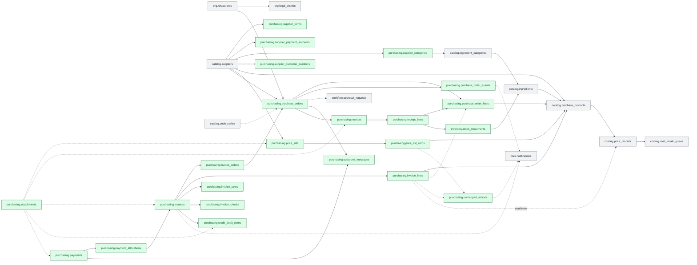

# Plan de la Fase 3 — Compras y facturas (Módulo 2 «Facturas»)

- **Fecha:** 2026-11-15
- **Estado:** propuesto. Falta la aprobación de Joaco, que también responde las preguntas P1 a P10 (o las pasa a Soy).
- **Fuentes:**
  - el documento de Soy, [fase-3-facturas.md](fase-3-facturas.md);
  - los prompts y las decisiones, [2026-11-14-facturas-modulo-2.md](../prompts/2026-11-14-facturas-modulo-2.md). **Mandan sobre el documento de Soy** donde lo ajustan a lo que ya existe en la base;
  - lo construido en las Fases 1 y 2 (migraciones hasta `20261201120000`, ADR-0001 a ADR-0048);
  - los 33 comprobantes reales que mandó Soy. Los miré fuera del repositorio. **Este plan no tiene ningún nombre, CUIT ni importe de ellos.**
- **ADR:** [0049](../decisiones/0049-modulo-de-compras-y-facturas.md).

## Resumen para Soy

El módulo cierra el circuito de compras: **proveedor → lista de precios → pedido → recepción → factura → pago**. Desde ahí, **el costo de cada materia prima sale de la última factura conforme**, sin cargarlo a mano.

Cuando esté terminado, cada persona va a poder hacer esto:

- **Compras (administración):**
  - carga la ficha completa de cada proveedor;
  - sube y acepta sus listas de precios;
  - carga las facturas por foto;
  - ve qué cerró solo y qué quedó observado;
  - registra los pagos y ve la cuenta corriente de cada proveedor.
- **Cocinero, jefe de cocina o gerente:**
  - arma el pedido desde el celular, con lo que más pide primero;
  - lo manda desde la cuenta de la empresa, nunca desde su teléfono;
  - recibe la mercadería con dos fotos del papel y un ✓ o ✕ por renglón;
  - se entera si hubo una novedad o una diferencia.
- **Chef:** le enseña al sistema, una sola vez, que «Azúcar marca X bolsa de 25 kg» es AZÚCAR. Después el sistema la reconoce sola.
- **Controller:** da por conforme lo que no cerró solo. Tiene que ser otra persona, distinta de quien cargó la factura.
- **Dirección:** ve el tablero de compras: gasto por rubro, cómo subieron los insumos, pedidos abiertos, facturas observadas y pagos que vencen. Recibe un aviso si un precio sube más del 15 %.

**Cómo se construye:** en 6 entregas, en el orden del circuito. Cada una deja algo usable: después de la primera ya se cargan proveedores; después de la tercera, ya se piden pedidos.

**Qué falta para arrancar:** que Joaco apruebe este plan y responda **10 preguntas nuevas** (punto 9). Salen de comparar el documento con la base y con las facturas reales.

---

## 1. Arquitectura y cómo se apoya en las Fases 1 y 2

### Lo que se reutiliza sin duplicar

La base ya tiene la mitad del modelo que pide Soy. Este módulo **completa** esas tablas en lugar de crear otras paralelas con los nombres del documento.

| Lo que pide Soy (sección «Modelo de datos») | Lo que ya existe y cumple ese papel                                                                                                                                                                                    | Qué se le agrega                                                                                     |
| ------------------------------------------- | ---------------------------------------------------------------------------------------------------------------------------------------------------------------------------------------------------------------------- | ---------------------------------------------------------------------------------------------------- |
| `proveedores`                               | `catalog.suppliers` (código, nombre, CUIT, interno, activo, notas)                                                                                                                                                     | Contacto y datos fiscales en la tabla; operativa, pago y rubros en tablas de `purchasing` (Prompt 1) |
| `insumos`                                   | `catalog.ingredients`, con su unidad de uso y su rubro (`catalog.ingredient_categories`)                                                                                                                               | Nada. Solo el rubro marca si va a recetas (pregunta P2)                                              |
| `articulos_proveedor`                       | `catalog.purchase_products`: `description` es el nombre de factura, `supplier_id` el proveedor, y el envase (`package_unit_id`, `units_per_package`, `content_per_unit`, `content_unit_id`) es el factor de conversión | `supplier_sku`, `billed_by_weight`, `estimated_weight_per_unit` (Prompt 2)                           |
| `costos_insumo`                             | `costing.price_records`: solo inserción, con el origen `invoice` reservado desde ADR-0029                                                                                                                              | `invoice_line_id` y un check que pide aprobación **o** línea de factura (Prompt 5)                   |
| `costos_vigentes`                           | `costing.resolve_prices` y `costing.price_rows` (local → marca → grupo, último aprobado, neto o bruto según la razón social, desactualizado)                                                                           | Nada                                                                                                 |
| Recálculo de recetas                        | `costing.cost_recalc_queue`, cada minuto (ADR-0032)                                                                                                                                                                    | Nada: el precio de factura entra por el mismo camino y dispara la cola                               |
| `alarmas`                                   | `core.notifications` (avisos por persona) y su enum `core.notification_kind`                                                                                                                                           | Tipos nuevos y la vista `reporting.v_purchasing_alerts` (Prompt 6)                                   |
| Numeración RAG-0001                         | `catalog.code_series` y `catalog.next_code` (ADR-0041), con bloqueo de fila                                                                                                                                            | Prefijo = código del local + «-» (Prompt 3)                                                          |
| Aprobación de OC                            | `workflow.approval_workflows` / `approval_requests`, con `approver_role_codes`, `excluded_approvers` y `apply_function`                                                                                                | El tipo `purchasing.approve_order` (Prompt 3)                                                        |
| Eventos                                     | `integration.integration_outbox` (`price.approved`, `cost.changed`)                                                                                                                                                    | Nada                                                                                                 |
| `adjuntos`                                  | El patrón de `recipe-media`: bucket privado, tipos y tamaño limitados, RLS por carpeta                                                                                                                                 | Bucket `purchasing-documents` y `purchasing.attachments` (Prompt 2)                                  |
| IVA recuperable                             | `org.legal_entities.vat_condition` y `org.restaurants.legal_entity_id` (ADR-0029)                                                                                                                                      | Nada                                                                                                 |
| Importes ocultos                            | `core.hide_costs` esconde las columnas que terminan en `_price` o `_amount`                                                                                                                                            | Toda columna de dinero del módulo se nombra así                                                      |
| Local activo                                | El selector global (`core.my_active_restaurant`, ADR-0048)                                                                                                                                                             | Nada: ninguna pantalla del módulo agrega otro selector de local                                      |

**No se crean** `articulos_proveedor`, `costos_insumo`, `costos_vigentes` ni `alarmas`: ya existen con los nombres de la tabla de arriba. El resto del sistema (Recetario, Costos, tableros) **nunca lee facturas ni artículos de proveedor**. Lee solo `resolve_prices`, como pide Soy para `costos_vigentes`.

### Reglas de diseño que se heredan

1. **RLS en la misma migración que crea la tabla.** Ninguna tabla existe sin RLS, ni por un momento.
2. **La API solo lee.** `authenticated` tiene `select` con RLS. Toda escritura va por funciones (RPC) que:
   - validan el permiso;
   - fijan el motivo y el origen (`core.set_change_context`);
   - dejan que los triggers completen las columnas de control y la auditoría.

   Nunca hay `delete`: el borrado es lógico.

3. **Políticas con conjuntos de ids** (`restaurant_id in (select core.permitted_restaurant_ids('purchasing.view_orders'))`), nunca una función por fila.
4. **Alcance consistente por estructura:** FKs compuestas `(restaurant_id, group_id)`, `(supplier_id, group_id)`, etc.
5. **Vistas con `security_invoker = true`.** Las de `reporting` nunca guardan datos propios.
6. **Solo inserción** en lo que es historia:
   - `inventory.stock_movements`;
   - `purchasing.invoice_checks`;
   - `purchasing.attachments`;
   - `costing.price_records` (ya lo es).

   Sin grant de `update` y con un trigger que rechaza `update` y `delete`.

7. **Dinero en `numeric(18,4)`**, siempre con nombre terminado en `_price` o `_amount`. Cantidades en `numeric(18,6)` con su unidad. Moneda ARS, como `price_records`.
8. **Auditoría** con `audit.log_change()` en cada tabla de negocio, y **`reject_truncate`**.
9. **Comentarios en español** en cada esquema, tabla y columna.

### Esquemas

- **`purchasing`** (nuevo, Prompt 1): todo el circuito. Proveedores ampliados, listas, OC, recepciones, facturas, notas de crédito y débito, pagos, adjuntos y mensajes salientes. Se expone por la API (`api.schemas` en `supabase/config.toml`) con RLS.
- **`inventory`** (nuevo, Prompt 4): **solo** `stock_movements` por ahora. `stock_locations` y `stock_counts` del prompt maestro quedan para la fase de inventario. Se expone para lectura.
- **`reporting`** (existe): vistas de cuenta corriente, agenda, alarmas y tablero (Prompt 6).
- La tabla de esquemas de `.claude/rules/database.md` se actualiza en el Prompt 1 (`purchasing`) y en el Prompt 4 (`inventory`).

### Dónde vive cada cosa

- **El control de 3 vías y la entrada del costo** están en la base, en funciones SQL (`purchasing.run_invoice_checks`, `purchasing.approve_invoice`). La pantalla solo muestra el resultado.
- **Los avisos que dependen del calendario** (lista vencida y pago por vencer) cuelgan del trabajo diario que ya existe (`grupo-lf-costos-diario`, 06:30, `costing.daily_refresh()`) o de uno nuevo con la misma forma. Cada aviso sale **una sola vez** por lista o por factura.
- **«Mandar OC» y el comprobante de pago** encolan un mensaje en `purchasing.outbound_messages`. Nadie lo despacha todavía (decisión 9 de Soy). La pantalla dice «En cola de envío». Cuando se defina WhatsApp Business o el mail, se agrega quien despache, sin tocar el resto.
- **Fotos:** se comprimen en el navegador antes de subir, como las de recetas. Van al bucket privado `purchasing-documents`, en carpetas `{group_id}/{tabla}/{registro}/…`, y Storage pide el mismo permiso que el registro.

---

## 2. Diagrama de entidades y relaciones

Los nombres llevan el esquema como prefijo (`catalog_suppliers` = `catalog.suppliers`). **En gris, lo que ya existe; en verde, lo nuevo.** Todas las tablas nuevas tienen además `group_id` y las columnas de control.

Los avisos (`core.notifications`) se crean desde las funciones; las flechas punteadas a `nt` son los principales.

---

## 3. Diccionario inicial de datos

Es la versión de diseño. El diccionario completo (tipos exactos, índices y restricciones) se **genera desde la base** en `docs/modulos/diccionario-datos.md` al cerrar cada prompt.

Las columnas de control y `group_id` van en todas las tablas y no se repiten abajo.

**Leyenda:**

- **SI** = solo inserción.
- **Lee** = permiso de lectura por RLS.
- **Escribe** = RPC y permiso.

### `catalog` (se completa)

| Tabla                   | Qué se agrega                                                                                                                                     | Reglas                                                                                                                                                                       | Prompt |
| ----------------------- | ------------------------------------------------------------------------------------------------------------------------------------------------- | ---------------------------------------------------------------------------------------------------------------------------------------------------------------------------- | ------ |
| `suppliers`             | `trade_name` (fantasía), `vat_condition` (`org.vat_condition`), `address`, `city`, `phone`, `whatsapp`, `email`, `sales_contact`, `admin_contact` | CUIT opcional (el puesto del mercado no tiene); si se carga, 11 números sin guiones y dígito verificador válido. Las filas de hoy no se tocan                                | 1      |
| `purchase_products`     | `supplier_sku` (código del proveedor), `billed_by_weight` boolean, `estimated_weight_per_unit` `numeric(18,6)` (en la unidad de uso)              | `supplier_sku` único por proveedor entre los vigentes. Un producto sin proveedor sigue valiendo para costos, pero no puede ir en una OC ni en una factura (lo exige la base) | 2      |
| `ingredient_categories` | `used_in_recipes` boolean, por defecto `true` (**pregunta P2**)                                                                                   | Limpieza, descartables y reventa: `false`. Sus materias primas no aparecen al armar una receta (decisión 6)                                                                  | 2      |

### `purchasing` (nuevo)

| Tabla                       | Para qué                                               | Columnas principales                                                                                                                                                                                                                                                                                                                                                                                                                                                                                                                                                                                                                                                                                      | Reglas                                                                                                                                                                                                                                                     | Lee / Escribe                                                                           | Prompt |
| --------------------------- | ------------------------------------------------------ | --------------------------------------------------------------------------------------------------------------------------------------------------------------------------------------------------------------------------------------------------------------------------------------------------------------------------------------------------------------------------------------------------------------------------------------------------------------------------------------------------------------------------------------------------------------------------------------------------------------------------------------------------------------------------------------------------------- | ---------------------------------------------------------------------------------------------------------------------------------------------------------------------------------------------------------------------------------------------------------- | --------------------------------------------------------------------------------------- | ------ |
| `supplier_terms`            | Operativa, facturación y pago (una fila por proveedor) | `supplier_id` (único), `order_days` y `delivery_days` `smallint[]` (1 = lunes … 7 = domingo), `receiving_from`, `receiving_to` `time`, `minimum_order_amount` (nulo), `po_channel` (enum `channel`), `po_channel_target`, `billing_modes` (`billing_mode[]`), `price_list_frequency` (`list_frequency`), `payment_terms` (`payment_terms`), `payment_days` (0 en contado)                                                                                                                                                                                                                                                                                                                                 | Días entre 1 y 7, sin repetidos. `receiving_from` < `receiving_to`. El dato del canal se valida según el canal (número, mail o URL). `requires_po_approval` boolean                                                                                        | Operativa: `view_suppliers`. Pago: `manage_suppliers` o Controller / `manage_suppliers` | 1      |
| `supplier_payment_accounts` | Cuentas para pagarle                                   | `supplier_id`, `method` (`payment_method`), `cbu`, `alias`, `bank`, `holder_name`, `holder_tax_id`, `is_active`                                                                                                                                                                                                                                                                                                                                                                                                                                                                                                                                                                                           | CBU de 22 números; alias según las reglas del BCRA; varias por proveedor                                                                                                                                                                                   | `manage_suppliers` o Controller / `manage_suppliers`                                    | 1      |
| `supplier_categories`       | Rubros que provee                                      | `supplier_id`, `category_id`                                                                                                                                                                                                                                                                                                                                                                                                                                                                                                                                                                                                                                                                              | Único por par                                                                                                                                                                                                                                              | `view_suppliers` / `manage_suppliers`                                                   | 1      |
| `supplier_customer_numbers` | Con qué número de cliente nos tiene cada proveedor     | `supplier_id`, `restaurant_id`, `customer_number`                                                                                                                                                                                                                                                                                                                                                                                                                                                                                                                                                                                                                                                         | Único por proveedor y local                                                                                                                                                                                                                                | `view_suppliers` / `manage_suppliers`                                                   | 1      |
| `unmapped_articles`         | Cola de artículos sin mapear                           | `supplier_id`, `raw_name`, `supplier_sku`, `package_hint`, `found_in` (`price_list`, `invoice`, `receipt`), `source_id`, `status` (`pending`, `resolved`, `discarded`), `purchase_product_id`, `resolved_by`, `resolved_at`                                                                                                                                                                                                                                                                                                                                                                                                                                                                               | Un pendiente por proveedor y nombre normalizado. Al entrar, aviso al chef (`unmapped_article`)                                                                                                                                                             | `catalog.map_articles` o `manage_price_lists` / `catalog.map_articles` resuelve         | 2      |
| `price_lists`               | Listas de precios de cada proveedor                    | `supplier_id`, `received_on`, `valid_from`, `status` (`received`, `accepted`, `replaced`), `accepted_by`, `accepted_at`, `notes`                                                                                                                                                                                                                                                                                                                                                                                                                                                                                                                                                                          | Una sola `accepted` por proveedor (índice único parcial). **«Vencida» se calcula, no se guarda** (punto 6, caso 7)                                                                                                                                         | `view_price_lists` / `manage_price_lists`                                               | 2      |
| `price_list_items`          | Precio por artículo en una lista                       | `price_list_id`, `purchase_product_id` **o** `unmapped_article_id` (check: exactamente uno), `list_price`, `bonus1_pct`, `bonus2_pct`, `vat_rate`, `price_includes_vat`                                                                                                                                                                                                                                                                                                                                                                                                                                                                                                                                   | El neto se calcula (bonificaciones en cascada). **Nunca va a `costing.price_records`**                                                                                                                                                                     | `view_price_lists` / `manage_price_lists`                                               | 2      |
| `attachments`               | Fotos y archivos                                       | `entity_table`, `entity_id`, `kind` (`doc_kind`), `page_number`, `storage_path`, `taken_at`, `taken_by`                                                                                                                                                                                                                                                                                                                                                                                                                                                                                                                                                                                                   | **SI.** Varias páginas por documento. Storage con RLS por carpeta                                                                                                                                                                                          | El permiso de ver la entidad / el de cargarla                                           | 2      |
| `purchase_orders`           | Orden de compra                                        | `restaurant_id`, `supplier_id`, `number` («RAG-0001»), `status` (`po_status`), `requested_by`, `expected_delivery_on`, `sent_at`, `sent_channel`, `notes`, `approval_request_id`                                                                                                                                                                                                                                                                                                                                                                                                                                                                                                                          | Número único por grupo; correlativo por local, sin saltos ni repetidos. La entrega esperada se calcula y se puede cambiar con motivo                                                                                                                       | `view_orders` en el local / `create_orders`                                             | 3      |
| `purchase_order_lines`      | Renglones de la OC                                     | `purchase_order_id`, `purchase_product_id` (del mismo proveedor) **o** `ingredient_id` (sin nombre de factura), `quantity` (en la unidad del envase), `received_quantity` (0 hasta recibir), `line_note`, `unit_price` y `price_list_item_id` (nulos: preparados para autocompletar)                                                                                                                                                                                                                                                                                                                                                                                                                      | Exactamente uno de producto o materia prima. No se puede pedir un producto de otro proveedor                                                                                                                                                               | Igual que la OC (sin precios para el cocinero)                                          | 3      |
| `purchase_order_events`     | Novedades y línea de tiempo                            | `purchase_order_id`, `kind` (`news`, `shortage`, `delivery_change`, `note`, `cancelled`), `message`                                                                                                                                                                                                                                                                                                                                                                                                                                                                                                                                                                                                       | **SI.** Una novedad pasa la OC a `with_news` y avisa al solicitante (`order_news`)                                                                                                                                                                         | `view_orders` / `record_order_news`                                                     | 3      |
| `outbound_messages`         | Mensajes al proveedor, en cola                         | `channel`, `target`, `subject`, `body`, `attachment_id`, `entity_table`, `entity_id`, `status` (`queued`, `sent`, `failed`, `cancelled`)                                                                                                                                                                                                                                                                                                                                                                                                                                                                                                                                                                  | Siempre desde la cuenta de la empresa. Hoy nadie la despacha (decisión 9)                                                                                                                                                                                  | `view_orders` o `view_payments` / solo funciones                                        | 3      |
| `receipts`                  | Recepción                                              | `purchase_order_id` (nulo si llegó sin OC), `restaurant_id` (el que recibe), `supplier_id`, `received_by`, `received_at`, `paper_kind` (`paper_kind`), `paper_number`, `status` (`open`, `closed`), `result` (`complete`, `partial`, `with_differences`), `cash_paid_amount` (nulo), `notes`                                                                                                                                                                                                                                                                                                                                                                                                              | Cerrar exige foto 1 (original) y foto 2 (firmada) y una decisión por cada renglón de la OC. Cerrada = no cambia                                                                                                                                            | `view_orders` en el local / `receive`                                                   | 4      |
| `receipt_lines`             | Lo recibido, renglón por renglón                       | `receipt_id`, `purchase_order_line_id` (nulo si no estaba), `purchase_product_id` o `unmapped_article_id`, `ok` boolean, `issue` (`receipt_issue`; obligatorio si no es ok), `received_quantity`, `received_weight` (kg, si va por peso), `lot_code` (**pregunta P9**), `note`                                                                                                                                                                                                                                                                                                                                                                                                                            | Lo que no estaba en la OC crea un artículo sin mapear si no se reconoce                                                                                                                                                                                    | Igual que la recepción                                                                  | 4      |
| `invoices`                  | Factura de compra (o comprobante)                      | `restaurant_id`, `supplier_id`, `legal_entity_id` (del local en ese momento), `invoice_class` (`invoice_class`), `point_of_sale`, `number`, `authorization_kind` (`cae`, `cai`, `caea`), `authorization_code`, `authorization_expires_on`, `issuer_tax_id`, `receiver_tax_id`, `issued_on`, `due_on`, `due_on_source` (`printed`, `terms`), `net_amount`, `exempt_amount`, `vat_amount`, `internal_tax_amount`, `perception_amount`, `discount_amount`, `rounding_amount`, `total_amount`, `supplier_balance_amount` (saldo que informa el proveedor, nulo), `status` (`invoice_status`), `observed_reason`, `loaded_by`, `approved_by`, `approved_at`, referencias (`remito_refs`, `supplier_order_ref`) | Única por proveedor, clase, punto de venta y número. Las partes suman el total (tolerancia 0,01). Conforme = no cambia (trigger). CUIT del emisor = el del proveedor; un emisor de ejemplo (99-99999999-9) o sin autorización en una clase fiscal se frena | `view_invoices` / `manage_invoices`                                                     | 5      |
| `invoice_orders`            | Qué OC cubre la factura                                | `invoice_id`, `purchase_order_id`                                                                                                                                                                                                                                                                                                                                                                                                                                                                                                                                                                                                                                                                         | Mismo proveedor y local                                                                                                                                                                                                                                    | Igual que la factura                                                                    | 5      |
| `invoice_lines`             | Renglones de la factura                                | `invoice_id`, `line_class` (`line_class`), `purchase_product_id` **o** `unmapped_article_id` (solo en `product`), `raw_name`, `units`, `billed_quantity` (kg si va por peso), `list_price`, `bonus1_pct`, `bonus2_pct`, `bonus_per_unit_amount` (**P6**), `unit_price` (neto), `vat_rate`, `is_exempt`, `internal_tax_amount`, `line_amount`, `purchase_order_line_id`                                                                                                                                                                                                                                                                                                                                    | `line_amount` = cantidad × precio neto (tolerancia 0,01). Con 99 % de bonificación o más, la línea es `free_of_charge`                                                                                                                                     | Igual que la factura                                                                    | 5      |
| `invoice_taxes`             | Percepciones y otros tributos                          | `invoice_id`, `tax_kind` (`iibb`, `vat_perception`, `municipal`, `other`), `jurisdiction`, `regime` (por ejemplo RG 3337), `rate_pct`, `tax_amount`                                                                                                                                                                                                                                                                                                                                                                                                                                                                                                                                                       | Suman a `perception_amount`. **Nunca al costo** (decisión 4)                                                                                                                                                                                               | Igual que la factura                                                                    | 5      |
| `invoice_checks`            | Resultado del control de 3 vías                        | `invoice_id`, `invoice_line_id` (nulo en los de la factura entera), `check_kind` (`quantity`, `price`, `mapping`, `totals`, `tax_id`, `legal_entity`), `expected`, `actual`, `passed`, `explanation` (en simple), `run_at`                                                                                                                                                                                                                                                                                                                                                                                                                                                                                | **SI.** Cada corrida agrega; la pantalla muestra la última                                                                                                                                                                                                 | Igual que la factura / solo funciones                                                   | 5      |
| `credit_debit_notes`        | NC, ND y descuentos                                    | `invoice_id`, `kind` (`credit`, `debit`, `discount`), `number`, `issued_on`, `note_amount`, `reason`                                                                                                                                                                                                                                                                                                                                                                                                                                                                                                                                                                                                      | Adjuntar una vuelve a correr el control                                                                                                                                                                                                                    | `view_invoices` / `manage_invoices`                                                     | 5      |
| `payments`                  | Pagos                                                  | `restaurant_id`, `supplier_id`, `paid_on`, `payment_account_id` (o `method` en efectivo), `reference`, `payment_amount`, `status` (`to_confirm`, `registered`, `receipt_queued`), `notes`                                                                                                                                                                                                                                                                                                                                                                                                                                                                                                                 | `to_confirm` = efectivo marcado en la recepción, que confirma Compras (decisión 7)                                                                                                                                                                         | `view_payments` / `pay`                                                                 | 6      |
| `payment_allocations`       | Qué factura cancela cada pago                          | `payment_id`, `invoice_id`, `allocated_amount`                                                                                                                                                                                                                                                                                                                                                                                                                                                                                                                                                                                                                                                            | La suma por factura no supera su saldo                                                                                                                                                                                                                     | Igual que el pago                                                                       | 6      |

### `inventory` (nuevo)

| Tabla             | Para qué                    | Columnas principales                                                                                                                                                                                                                        | Reglas                                                                                                    | Lee / Escribe                     | Prompt |
| ----------------- | --------------------------- | ------------------------------------------------------------------------------------------------------------------------------------------------------------------------------------------------------------------------------------------- | --------------------------------------------------------------------------------------------------------- | --------------------------------- | ------ |
| `stock_movements` | Entradas de stock por local | `restaurant_id`, `ingredient_id`, `purchase_product_id`, `kind` (`purchase_receipt`; previstos sin usar: `sale`, `adjustment`, `count`), `base_quantity` (en la unidad de uso), `package_quantity`, `moved_at`, `source_table`, `source_id` | **SI**, solo desde `close_receipt`. Por peso, entra el peso recibido. Nada descuenta todavía (decisión 8) | `inventory.view` / solo funciones | 4      |

### `costing` (ajuste)

| Tabla           | Qué cambia                                                                                                                                                                                                                                                                        | Prompt |
| --------------- | --------------------------------------------------------------------------------------------------------------------------------------------------------------------------------------------------------------------------------------------------------------------------------- | ------ |
| `price_records` | Columna `invoice_line_id`. El check de aprobación pasa a pedir: solicitud aprobada, **o** línea de factura (`source = 'invoice'`), **o** valor de prueba. `approved_by` = quien dio la factura por conforme. Se corrige el comentario del enum `price_source` («Fase 5» → Fase 3) | 5      |

### `reporting` (vistas, Prompts 2 y 6)

- `v_price_list_changes`: variación % por artículo entre dos listas aceptadas seguidas.
- `v_supplier_account` y `v_supplier_account_movements`: cuenta corriente y movimientos con saldo acumulado.
- `v_payment_schedule`: agenda de vencimientos.
- `v_purchasing_alerts`: alarmas pendientes.
- `v_purchasing_kpis`: tablero.
- `v_ingredient_cost_history`: evolución del costo.
- `v_price_list_impact`: aumentos ponderados por compra.

Todas con `security_invoker`. Las del tablero con `explain analyze` < 300 ms.

### Tipos (enums) nuevos

| Tipo                                 | Valores                                                                                                                                               | Qué es                                                                      |
| ------------------------------------ | ----------------------------------------------------------------------------------------------------------------------------------------------------- | --------------------------------------------------------------------------- |
| `channel`                            | `whatsapp`, `email`, `supplier_portal`                                                                                                                | Por dónde se le manda la OC                                                 |
| `billing_mode`                       | `a`, `b`, `c`, `invoice_remito`, `remito_then_invoice`, `non_fiscal`, `handwritten_note`                                                              | Cómo factura el proveedor (puede ser más de uno)                            |
| `list_frequency`                     | `weekly`, `biweekly`, `monthly`                                                                                                                       | Cada cuánto manda la lista                                                  |
| `payment_terms`                      | `cash`, `cash_on_delivery`, `same_day_transfer`, `account`                                                                                            | Condición de pago; los días cuentan desde la fecha de la factura            |
| `payment_method`                     | `cash`, `transfer`, `check`, `echeq`, `card` (+ `electronic_code`, **pregunta P10**)                                                                  | Medio de pago                                                               |
| `doc_kind`                           | `price_list`, `receipt_original`, `receipt_signed`, `product_issue`, `invoice_original`, `credit_note`, `payment_receipt`                             | Qué muestra un adjunto                                                      |
| `po_status`                          | `draft`, `pending_approval`, `sent`, `with_news`, `partially_received`, `received`, `closed`, `cancelled`                                             | Estado de la OC (el «facturada/cerrada» de Soy es `closed`)                 |
| `paper_kind`                         | `invoice`, `invoice_remito`, `remito`, `electronic_remito`, `non_fiscal`, `handwritten_note`                                                          | El papel que llegó con la mercadería                                        |
| `receipt_issue`                      | `missing`, `extra`, `different_product`, `quality`, `expired`                                                                                         | Tipo de observación al recibir                                              |
| `invoice_class`                      | `invoice_a`, `invoice_b`, `invoice_c`, `invoice_remito_a`, `non_fiscal`, `handwritten_note`                                                           | Clase de comprobante. Los remitos R y el harinero se cargan en la recepción |
| `authorization_kind`                 | `cae`, `cai`, `caea`                                                                                                                                  | Autorización fiscal                                                         |
| `invoice_status`                     | `loaded`, `in_control`, `observed`, `approved`, `released`, `paid`, `cancelled`                                                                       | Estado de la factura                                                        |
| `line_class`                         | `product`, `freight`, `service`, `rounding`, `deposit`, `free_of_charge`                                                                              | Qué es cada renglón                                                         |
| `tax_kind`                           | `iibb`, `vat_perception`, `municipal`, `other`                                                                                                        | Percepciones y otros tributos                                               |
| `core.notification_kind` (se amplía) | `unmapped_article`, `price_list_expired`, `order_news`, `receipt_report`, `receipt_differences`, `invoice_observed`, `price_variation`, `payment_due` | Avisos del módulo                                                           |

---

## 4. Permisos nuevos y reparto por rol

Código = módulo.acción. El alcance sale de la asignación de cada persona (grupo, marca o local), no de esta tabla. **El superadmin no recibe permisos de negocio** (como en la Fase 2).

Leyenda:

- ✓ = tiene el permiso;
- L = solo en su local;
- — = no lo tiene;
- **S** = sensible: queda en el historial de permisos y su asignación pasa por la regla de roles sensibles.

| Permiso                         |   S   | Dirección | Dir. de Marca | Gerente |    Chef Ejec.    | Jefe de Cocina | Controller | Compras | Cocinero | Auditor |
| ------------------------------- | :---: | :-------: | :-----------: | :-----: | :--------------: | :------------: | :--------: | :-----: | :------: | :-----: |
| `purchasing.view_suppliers`     |       |     ✓     |       ✓       |    ✓    |        ✓         |       ✓        |     ✓      |    ✓    |    ✓     |    ✓    |
| `purchasing.manage_suppliers`   | **S** |     ✓     |       —       |    —    |        —         |       —        |     —      |    ✓    |    —     |    —    |
| `purchasing.view_price_lists`   |       |     ✓     |       ✓       |    L    |        —         |       —        |     ✓      |    ✓    |    —     |    ✓    |
| `purchasing.manage_price_lists` | **S** |     —     |       —       |    —    |        —         |       —        |     —      |    ✓    |    —     |    —    |
| `catalog.map_articles`          |       |     —     |       —       |    —    |        ✓         |       ✓        |     —      |    —    |    —     |    —    |
| `purchasing.view_orders`        |       |     ✓     |       ✓       |    L    |        ✓         |       L        |     ✓      |    ✓    |    L     |    ✓    |
| `purchasing.create_orders`      |       |     —     |       —       |    L    |        ✓         |       L        |     —      |    ✓    |    L     |    —    |
| `purchasing.approve_orders`     |       |     —     |       —       |    —    |        —         |       —        |     —      |    ✓    |    —     |    —    |
| `purchasing.record_order_news`  |       |     —     |       —       |    L    |        —         |       —        |     —      |    ✓    |    —     |    —    |
| `purchasing.receive`            |       |     —     |       —       |    L    |        —         |       L        |     —      |    ✓    |    L     |    —    |
| `purchasing.view_invoices`      |       |     ✓     |       ✓       |    L    |        —         |       —        |     ✓      |    ✓    |    —     |    ✓    |
| `purchasing.manage_invoices`    |       |     —     |       —       |    —    |        —         |       —        |     —      |    ✓    |    —     |    —    |
| `purchasing.approve_invoices`   | **S** |     —     |       —       |    —    |        —         |       —        |     ✓      |    ✓    |    —     |    —    |
| `purchasing.pay`                | **S** |     —     |       —       |    —    |        —         |       —        |     —      |    ✓    |    —     |    —    |
| `purchasing.view_payments`      |       |     ✓     |       ✓       |    L    |        —         |       —        |     ✓      |    ✓    |    —     |    ✓    |
| `purchasing.view_dashboard`     |       |     ✓     |       ✓       |    L    | ✓ (sin importes) |       —        |     ✓      |    ✓    |    —     |    ✓    |
| `inventory.view`                |       |     ✓     |       ✓       |    L    |        ✓         |       L        |     ✓      |    —    |    —     |    ✓    |

Notas:

- **Quién es quién** (archivo de prompts): «administración» = Compras para cargar y Controller para dar por conforme lo que no cierra solo; «cocinero» = Cocinero, Jefe de Cocina y Gerente, cada uno en su local; «chef» = Chef Ejecutivo y Jefe de Cocina.
- **`approve_invoices` lo tienen Compras y el Controller**, pero la función rechaza a quien cargó esa factura (decisión 2 de Soy). La base lo valida, no la pantalla.
- **`approve_orders` = Compras**, y nunca quien pidió la OC (`excluded_approvers`, decisión 3).
- **Cuentas bancarias y condición de pago:** las lee solo quien tiene `manage_suppliers`, o el Controller. El cocinero ve nombre, contacto, días y canal. Se protege con una vista sin esas columnas o con RLS en tablas separadas (`supplier_payment_accounts` ya lo es). La base lo hace, no la pantalla.
- **Importes:** quien no tiene `recipes.view_costs` no ve columnas `_price` ni `_amount` en el historial (`core.hide_costs`). El cocinero no ve precios de lista ni de factura en ninguna parte.
- **El auditor** lee todo el módulo. Ve importes porque su rol ya tiene `recipes.view_costs` (Fase 2).
- **Compras no mapea artículos** (`catalog.map_articles` es del chef, como pide Soy). Sí puede ver la cola.
- El reparto se carga en `core.role_permissions` y aparece en la matriz de permisos (ADR-0039), donde Soy lo puede cambiar.

---

## 5. Pantallas

Todas siguen `.claude/rules/design.md`:

- **computadora para operar, celular para supervisar**;
- tres tipos de pantalla (A paneles, B carga, C listados);
- las fichas sin scroll en 1440 × 900;
- `Metric`, `SegmentedField`, `ToggleField`, la barra fija con contador y motivo, y los paneles laterales;
- **ningún selector de local propio:** se usa el de arriba.

| #   | Pantalla de Soy            | Ruta                                           | Tipo                           | Dispositivo principal                   | Pregunta que responde                               | Barra lateral                          | Prompt  |
| --- | -------------------------- | ---------------------------------------------- | ------------------------------ | --------------------------------------- | --------------------------------------------------- | -------------------------------------- | ------- |
| 1   | Proveedores (lista)        | `/proveedores`                                 | C                              | Computadora                             | ¿A quién le compramos y en qué condiciones?         | Base de conocimiento                   | 1       |
| 1   | Ficha de proveedor         | `/proveedores/[id]`                            | B sin scroll                   | Computadora; celular consulta           | ¿Cómo se le pide, cuándo entrega y cómo se le paga? | —                                      | 1, 2, 6 |
| 2   | Cola de mapeo              | `/materias-primas?pestaña=sin-mapear`          | C (pestaña en Materias primas) | Computadora; celular resuelve con 44 px | ¿Qué artículos nuevos falta enseñarle al sistema?   | Base de conocimiento (Materias primas) | 2       |
| 3   | Listas de precios          | `/listas-de-precios`                           | C con detalle en panel         | Computadora                             | ¿Qué lista vale hoy y cuánto subió?                 | Gestión y análisis                     | 2       |
| 4   | Nueva OC                   | `/compras/ordenes/nueva`                       | Carga en pasos                 | **Celular primero**                     | ¿Qué le pido a este proveedor?                      | —                                      | 3       |
| 5   | Órdenes de compra / Mis OC | `/compras/ordenes` y `/compras/ordenes/[id]`   | C + ficha                      | Computadora y celular                   | ¿Qué pedí, en qué estado está y hubo novedades?     | Gestión y análisis                     | 3       |
| 6   | Recepción                  | `/compras/recepcion`                           | Un paso por pantalla           | **Celular primero**, 44 px              | ¿Llegó lo que pedimos?                              | Gestión y análisis                     | 4       |
| —   | Inventario                 | `/inventario`                                  | C (informe)                    | Computadora                             | ¿Qué entró, cuándo y dónde?                         | Gestión y análisis                     | 4       |
| 7   | Facturas                   | `/compras/facturas` y `/compras/facturas/[id]` | C + ficha B sin scroll         | Computadora                             | ¿Esta factura está bien para pagarla?               | Gestión y análisis                     | 5       |
| 8   | Pagos                      | `/compras/pagos`                               | C con panel de pago            | Computadora                             | ¿Qué hay que pagar y a quién le debemos?            | Gestión y análisis                     | 6       |
| 9   | Tablero de compras         | `/compras`                                     | A sin scroll (como el Inicio)  | Computadora; celular resumen            | ¿Cómo vienen las compras y qué requiere atención?   | Gestión y análisis                     | 6       |

- **La barra inferior del celular no cambia** (Inicio, Recetas, Reportes, Control). Lo nuevo entra en «Menú».
- **Aprobaciones de OC:** en la bandeja que ya existe (`/aprobaciones`), con las líneas de la OC. No se crea otra bandeja.
- La navegación tiene que seguir entrando sin scroll en 1440 px con 7 entradas más. Se mide en el Prompt 1 y en el 6; si no entra, se propone agrupar bajo «Compras».

---

## 6. Reglas exactas y casos con la cuenta hecha

### Unidades y precisión

- **Importes:** `numeric(18,4)`. **Precio unitario:** `numeric(18,4)`; en las facturas reales hay precios con 3 y 4 decimales y alcanza.
- **Cantidades y pesos:** `numeric(18,6)`.
- **Costo por unidad de uso:** lo calcula `price_rows`, como hoy (`numeric(20,8)`).
- **Tolerancias:**
  - 0,01 en importes de línea y totales;
  - 0 en precio contra lista;
  - 0,5 % en peso facturado contra recibido, configurable por grupo.

### Reglas

| Regla                   | Cómo se calcula                                                                                                                                                                                                                                                                                                            |
| ----------------------- | -------------------------------------------------------------------------------------------------------------------------------------------------------------------------------------------------------------------------------------------------------------------------------------------------------------------------- |
| Número de OC            | Prefijo = código del local + «-» (`RAG-`). Contador en `catalog.code_series` con el `update … returning` de `catalog.next_code`: la fila queda bloqueada hasta el commit, y si la transacción falla el número vuelve. Sin saltos ni repetidos. 4 cifras, que crecen solas                                                  |
| Entrega esperada        | El primer día de `delivery_days` **posterior** a la fecha del pedido (si hoy es día de entrega, el próximo). Sin días cargados → error claro. Se cambia a mano con motivo                                                                                                                                                  |
| Ranking de artículos    | Cantidad de OC enviadas o recibidas del local que incluyen el artículo, de mayor a menor; empate por nombre. Se calcula desde la historia, sin contadores                                                                                                                                                                  |
| Lista vencida           | Hoy (Argentina) > `valid_from` + plazo (semanal 7, quincenal 15, mensual 31 días). Se calcula, no se guarda. El aviso sale una vez por lista                                                                                                                                                                               |
| Reconocer un artículo   | 1) proveedor + `supplier_sku`; 2) si no hay código, proveedor + descripción normalizada (mayúsculas, sin puntos ni espacios dobles); 3) si no, a la cola de mapeo                                                                                                                                                          |
| Neto con bonificaciones | `neto = lista × (1 − b1) × (1 − b2) − bonificación por unidad (P6)`                                                                                                                                                                                                                                                        |
| Control de cantidad     | Cantidad facturada = recibida en esa línea (con las observaciones de la recepción). Por peso: kg facturados contra kg recibidos, ±0,5 %                                                                                                                                                                                    |
| Control de precio       | Precio neto facturado = neto de la lista **aceptada vigente a la fecha de la factura**. Sin lista, o sin el artículo en la lista → no pasa («Sin lista de precios vigente»)                                                                                                                                                |
| Control de mapeo        | Toda línea `product` tiene producto de compra                                                                                                                                                                                                                                                                              |
| Control de totales      | neto gravado + exento + IVA + impuestos internos + percepciones − bonificación general + redondeo = total (±0,01)                                                                                                                                                                                                          |
| Control de CUIT         | Emisor = CUIT del proveedor (si no, no se guarda). Receptor = razón social del local que recibió; si es la de otro local → observada «Facturada a otra razón social»                                                                                                                                                       |
| Costo desde la factura  | Por cada línea `product` (no `free_of_charge`) se registra un `price_records`: `package_price` = precio neto unitario por envase, sin impuestos internos ni percepciones, alcance local, `valid_from` = fecha de la factura. `price_rows` da el neto solo con factura A y razón social RI; con B o C, el costo es el total |
| Vencimiento de pago     | El impreso en la factura; si no hay, fecha + `payment_days` (contado = la misma fecha). **El vencimiento del CAE nunca se usa como vencimiento de pago**                                                                                                                                                                   |
| Saldo de una factura    | total − NC − descuentos + ND − pagos aplicados. En 0 → `paid`, en la misma transacción                                                                                                                                                                                                                                     |
| Agenda                  | Vencida si vence < hoy (Crítico); «Vence en 7 días» si vence ≤ hoy + 7 (Atención); si no, Al día. Siempre con palabra                                                                                                                                                                                                      |
| Stock                   | `base_quantity = catalog.to_base_quantity(producto, envases)`; por peso, el peso recibido en la unidad de uso                                                                                                                                                                                                              |

### Los casos, con la cuenta hecha

| #   | Caso                         | Cuenta                                                                                 | Esperado                                                                           | Prompt | Dónde          |
| --- | ---------------------------- | -------------------------------------------------------------------------------------- | ---------------------------------------------------------------------------------- | ------ | -------------- |
| 1   | CUIT válido                  | 20-12345678-6 (dígito verificador calculado)                                           | Se guarda como `20123456786`                                                       | 1      | pgTAP + Vitest |
| 2   | CUIT inválido                | El mismo con el último dígito cambiado                                                 | Rechazado: «El CUIT no es válido»                                                  | 1      | pgTAP + Vitest |
| 3   | Horario                      | Recibe de 10:00 a 08:00                                                                | Rechazado                                                                          | 1      | pgTAP + Vitest |
| 4   | Canal                        | Canal portal con dato «no es una URL»                                                  | Rechazado                                                                          | 1      | pgTAP + Vitest |
| 5   | Bonificaciones en cascada    | Lista 100 · 15 % · 10 % → 100 × 0,85 × 0,90                                            | Neto 76,50                                                                         | 2      | pgTAP + Vitest |
| 6   | Una sola lista aceptada      | Aceptar la lista 2 del mismo proveedor                                                 | La 1 pasa a `replaced` en la misma transacción                                     | 2      | pgTAP          |
| 7   | Lista vencida (borde)        | Semanal, vigente desde el 1/11; hoy 8/11 → 1 + 7 = 8, no es mayor                      | **Al día** el 8; vencida el 9. El aviso sale una vez                               | 2      | pgTAP          |
| 8   | Mapear un artículo           | «AZUCAR X 25KG» → AZÚCAR, bolsa × 25 kg                                                | Producto con factor «1 bolsa = 25 kg»; la cola queda `resolved`                    | 2      | pgTAP + Vitest |
| 9   | Proveedor que renombra       | «AZUCAR 25K» → «Es el mismo que…»                                                      | Se vincula al producto existente; la historia no cambia                            | 2      | pgTAP          |
| 10  | Lista ≠ costo                | Aceptar una lista                                                                      | 0 filas nuevas en `costing.price_records`                                          | 2      | pgTAP          |
| 11  | Numeración                   | Dos cocineros del local RAG piden a la vez                                             | RAG-0001 y RAG-0002, sin repetir ni saltar; en otro local, su propia serie         | 3      | pgTAP          |
| 12  | Entrega esperada             | Entrega martes y viernes; pedido el martes                                             | El viernes de esa semana                                                           | 3      | pgTAP          |
| 13  | Entrega sin días             | Proveedor sin días de entrega                                                          | Error: «Cargá los días de entrega del proveedor»                                   | 3      | pgTAP          |
| 14  | Ranking                      | Artículo A en 5 OC, B en 2                                                             | A primero                                                                          | 3      | pgTAP          |
| 15  | Aprobación de OC             | Proveedor con «requiere aprobación»; aprueba quien la pidió                            | Rechazado; con Compras (otra persona) pasa y se encola el mensaje                  | 3      | pgTAP          |
| 16  | Stock                        | 2 bolsas de 50 kg, unidad de uso g                                                     | 100.000 g                                                                          | 4      | pgTAP          |
| 17  | Recepción parcial            | Pedidas 10 cajas, llegaron 8 (faltante)                                                | `received_quantity` 8, OC `partially_received`, aviso a Compras                    | 4      | pgTAP          |
| 18  | Cerrar sin la foto 2         | —                                                                                      | Error claro                                                                        | 4      | pgTAP          |
| 19  | Conforme sola, A con RI      | Bolsa de 50 kg a $ 60.500 con IVA 21 % → neto 50.000; igual a lo recibido y a la lista | `approved` y `released`; `price_records` con costo **$ 1.000/kg**                  | 5      | pgTAP          |
| 20  | La misma en B                | $ 60.500 sin IVA recuperable                                                           | Costo **$ 1.210/kg**                                                               | 5      | pgTAP          |
| 21  | Impuestos internos           | Línea neta $ 10.000 con $ 2.000 de internos                                            | `price_records` con $ 10.000; los $ 2.000 cuentan para el total y el pago          | 5      | pgTAP          |
| 22  | Percepciones y flete         | Factura con 3 % de percepción de IIBB y un flete                                       | Ninguno cambia un costo; ambos suman al total                                      | 5      | pgTAP          |
| 23  | Regalo                       | Línea con 99,99 % de bonificación                                                      | `free_of_charge`; no cambia ningún costo                                           | 5      | pgTAP          |
| 24  | Precio distinto              | Lista $ 1.000, factura $ 1.001                                                         | `observed` por precio (tolerancia 0), aviso a Compras                              | 5      | pgTAP          |
| 25  | Peso dentro de la tolerancia | Recibidos 32,80 kg, facturados 32,95 kg (+0,46 %)                                      | Pasa                                                                               | 5      | pgTAP          |
| 26  | NC que cierra                | Observada por $ 500 de más; NC por $ 500                                               | Vuelve a controlar y queda conforme                                                | 5      | pgTAP          |
| 27  | Conforme a mano              | La da quien la cargó / la da el Controller                                             | Rechazado / pasa, con motivo                                                       | 5      | pgTAP          |
| 28  | Variación grande             | Precio vigente $ 1.000; factura $ 1.200 (+20 % > 15 %)                                 | El precio entra igual y Dirección recibe el aviso con anterior, nuevo y diferencia | 5      | pgTAP          |
| 29  | Emisor de ejemplo            | CUIT 99-99999999-9, sin CAE, clase A                                                   | No se guarda                                                                       | 5      | pgTAP          |
| 30  | Totales que no cierran       | Las partes suman $ 0,02 menos que el total                                             | Rechazado                                                                          | 5      | pgTAP          |
| 31  | Pago parcial y total         | Factura de $ 1.000: pago de $ 400 → saldo $ 600; pago de $ 600 → `paid`                | En la misma transacción                                                            | 6      | pgTAP          |
| 32  | Un pago, dos facturas        | $ 1.500 a facturas de $ 1.000 y $ 500                                                  | Las dos `paid`; aplicar $ 1.001 a la primera → rechazado                           | 6      | pgTAP          |
| 33  | Agenda (bordes)              | Vence hoy / venció ayer / vence en 7 días                                              | Atención / Crítico / Atención                                                      | 6      | pgTAP          |
| 34  | Tablero                      | 500 facturas, 5.000 líneas                                                             | Cada consulta < 300 ms (`explain analyze` en el ADR)                               | 6      | pgTAP          |

Además, en cada prompt: RLS por rol y alcance, auditoría con motivo y que los precios de hoy (`210`, `211`, `212`) sigan en verde sin aflojarlos.

---

## 7. Orden de construcción

Cada prompt sigue los 6 pasos del método: plan aprobado, base primero con pgTAP, interfaz, todas las pruebas, los tres revisores y PR con resumen en simple. **Un PR por prompt.**

| PR  | Rama                                 | Qué deja usable                                                                                          | Compuerta: quién valida y con qué                                                                                           |
| --- | ------------------------------------ | -------------------------------------------------------------------------------------------------------- | --------------------------------------------------------------------------------------------------------------------------- |
| 1   | `feat/proveedores`                   | Lista y ficha completa de proveedor (sin scroll), esquema `purchasing`, permisos del módulo              | Compras (o Joaco) carga en staging 3 proveedores ficticios con todas las clases de facturación y las condiciones de pago    |
| 2   | `feat/articulos-y-listas-de-precios` | Artículos con código del proveedor, cola de mapeo, listas de precios aceptadas e históricas, adjuntos    | El chef mapea los 3 artículos sin mapear del seed; Compras acepta una lista y ve la vencida                                 |
| 3   | `feat/ordenes-de-compra`             | OC desde el celular con ranking, numeración por local, aprobación opcional, mensaje en cola y novedades  | Un cocinero de prueba arma una OC en el celular en menos de 2 minutos; Compras aprueba una                                  |
| 4   | `feat/recepcion`                     | Recepción con dos fotos, ✓/✕ por renglón, peso recibido, sin OC, pago en efectivo, entradas de stock     | El gerente de prueba recibe una OC con un faltante en el celular                                                            |
| 5   | `feat/facturas`                      | Facturas con control de 3 vías, NC/ND, conforme a mano por otra persona, **el costo sale de la factura** | Joaco y el Controller cargan los comprobantes inventados de cada clase de papel y controlan el costo a mano (casos 19 a 30) |
| 6   | `feat/pagos-y-tablero-de-compras`    | Pagos, cuenta corriente, agenda, alarmas y tablero                                                       | Soy mira el tablero en staging con datos de prueba                                                                          |

**Compuerta de la Fase 3** (la valida Soy antes de cargar proveedores reales en producción):

1. En staging, con datos ficticios, recorre el circuito completo: proveedor → lista → OC → recepción → factura → pago.
2. Un precio de factura cambia el costo de una receta en Costos, con su origen.
3. La cuenta corriente y el tablero muestran lo esperado.

Recién ahí Compras carga los proveedores reales en producción (P1).

---

## 8. Riesgos

- **Productos de compra sin proveedor.** En staging y producción hay productos cargados desde la ficha de materia prima con el proveedor vacío. Siguen valiendo para costos, pero no pueden ir en una OC ni en una factura (Prompt 2). Al mapear un artículo del proveedor se crea un producto nuevo; el viejo queda.
- **Precios de prueba (`test_value`) que conviven con los de factura.** `resolve_prices` toma el último por vigencia y número de entrada, sin mirar el origen. Ejemplo: un valor de prueba del 1/11 y una factura del 5/11 → gana la factura. Una factura con fecha 30/10 cargada después **no** gana a un valor de prueba del 1/11. El plan propone mostrarlo en Calidad de datos («precio de prueba más nuevo que la última factura»).
- **Dos cocineros que piden a la vez:** lo resuelve el bloqueo de `code_series` (caso 11). Se prueba con dos sesiones.
- **Locales sin código.** Los 4 locales del seed no tienen `code`, y sin código no hay «RAG-0001». Hay que exigirlo o completarlo (P3). El seed del Prompt 3 los completa.
- **El cambio en `price_records` (Prompt 5) toca la única fuente de costos.** Va con `security-auditor` obligatorio y sin aflojar las pruebas `210`, `211` y `212`. El comentario del enum `price_source` dice «Fase 5»: se corrige.
- **Aprobación de precios (ADR-0029).** Para los precios de factura deja de haber solicitud (decisión 1). El camino de hoy sigue para los precios sin factura.
- **La navegación crece en 7 entradas.** Hay que medir que entre sin scroll en 1440 px.
- **Rendimiento del tablero** con datos multiplicados (500 facturas). Si una vista no llega a 300 ms, pasa a materializada con refresco diario.
- **Fotos:** las de facturas pesan (las reales escaneadas, varios MB por página). Se comprimen en el navegador, con un límite de 10 MB por archivo.
- **Datos reales.** Los PDF de Soy **nunca** entran al repo, al seed, a las capturas ni a un servicio externo. El seed copia **la forma** de cada clase de papel con proveedores, CUIT e importes inventados.
- **Envío real (WhatsApp o mail):** queda la cola y nadie la despacha. Hasta que se defina, Compras manda el mensaje a mano. La pantalla lo tiene que decir claro para que nadie crea que salió.

---

## 9. Decisiones

### Las de Soy (todas respondidas)

| #   | Decisión                                                                                          | Prompt que la usa |
| --- | ------------------------------------------------------------------------------------------------- | ----------------- |
| D1  | Compras y numeración de OC por local (RAG-0001)                                                   | 3                 |
| D2  | Costo vigente = última compra conforme, neta de IVA con factura A                                 | 5                 |
| D3  | El remito valida lo recibido; la factura manda para los costos                                    | 4, 5              |
| D4  | La factura se carga por foto y la valida administración; OCR y ARCA después                       | 5                 |
| D5  | Listas: las sube y acepta administración, con histórico; agente de carga después                  | 2                 |
| D6  | Aprobación de OC configurable por proveedor                                                       | 1, 3              |
| D7  | Pagos: agenda y cuenta corriente, simple                                                          | 6                 |
| D8  | La recepción registra entradas de stock; el descuento por ventas, preparado y no activo           | 4                 |
| D9  | «Mandar OC» por el canal de la ficha, desde la cuenta de la empresa; queda en cola                | 3, 6              |
| D10 | El cocinero da de alta materias primas; un artículo nuevo va a la cola de mapeo con aviso al chef | 2                 |
| 1   | Factura conforme = precio aprobado; una variación mayor al % entra igual y avisa a Dirección      | 5                 |
| 2   | El conforme a mano lo da otra persona distinta de quien cargó; lo valida la base                  | 5                 |
| 3   | La OC que requiere aprobación la aprueba Compras, nunca quien la pidió                            | 3                 |
| 4   | Ni los impuestos internos ni las percepciones suman al costo                                      | 5                 |
| 5   | Flete, envío y servicios no se reparten: son gasto de la factura                                  | 5, 6              |
| 6   | Limpieza, descartables y reventa: materias primas en rubros que no van a recetas                  | 2                 |
| 7   | En la recepción se marca «Se pagó en efectivo» con el importe, y Compras lo confirma              | 4, 6              |

### Preguntas nuevas

Salen de comparar el documento con la base y con las facturas reales. **Nada se decide en el plan.** Cada una lleva una recomendación.

| #   | Para                 | Pregunta                                                                                                                                                                                                                         | Recomendación                                                                                                                                         | Prompt |
| --- | -------------------- | -------------------------------------------------------------------------------------------------------------------------------------------------------------------------------------------------------------------------------- | ----------------------------------------------------------------------------------------------------------------------------------------------------- | ------ |
| P1  | Joaco                | ¿Una importación desde planilla para los ~30 proveedores reales, con el patrón del importador de recetas (ADR-0027)?                                                                                                             | Sí, chica: una hoja con la ficha y los días; se usa solo en producción, por Compras. En el mismo Prompt 1 si entra, o en un PR inmediatamente después | 1      |
| P2  | Joaco                | Para «no va a recetas» (decisión 6), ¿una columna nueva `used_in_recipes` en el rubro? Hoy el rubro no tiene nada parecido                                                                                                       | Sí, en el rubro de primer nivel; sus subrubros la heredan                                                                                             | 2      |
| P3  | Soy y Joaco          | Los locales sin código no pueden numerar OC. ¿Se exige el código para pedir, y se completa desde el Panel de control?                                                                                                            | Sí: sin código, «Nueva OC» dice «Falta el código del local» y enlaza al Panel                                                                         | 3      |
| P4  | Soy                  | Facturas de servicios o sin OC ni recepción (un flete aparte, un servicio de traslado con período facturado). El control de 3 vías no aplica: ¿alcanza con Compras, o el conforme lo da otra persona como en las que no cierran? | Que la dé otra persona (misma regla que la decisión 2): es la única barrera para un pago sin mercadería                                               | 5      |
| P5  | Soy, con el contador | El pie de ARCA tiene alícuotas de 2,5 % y 5 % (en las facturas recibidas, siempre en cero). Hoy un precio solo admite 0, 10,5, 21 y 27 %. ¿Se amplían?                                                                           | Sí, en las líneas de factura y en `price_records`, para no frenar una factura válida                                                                  | 5      |
| P6  | Soy                  | Hay bonificación en pesos por caja, además del %. ¿Se guarda como descuento por unidad?                                                                                                                                          | Sí: `bonus_per_unit_amount`, que se resta después de los %                                                                                            | 2, 5   |
| P7  | Joaco                | El QR de ARCA de cada factura electrónica trae CUIT, punto de venta, número, fecha, total y CAE. Leerlo de la foto prellena la cabecera sin OCR ni servicio externo. ¿Entra en el Prompt 5 o queda con OCR/ARCA para después?    | Para después (Soy lo dejó fuera); el Prompt 5 deja el lugar en el modal                                                                               | 5      |
| P8  | Soy                  | Algunas facturas dicen «monto sujeto a retención». ¿Alguna razón social del grupo es agente de retención? Si lo es, el pago tiene que calcularla                                                                                 | Fuera de esta fase, preparado (una columna en el pago)                                                                                                | 6      |
| P9  | Soy                  | Algunos remitos traen el lote del producto. ¿Se carga el lote en la recepción (opcional)?                                                                                                                                        | Sí, opcional, por renglón: sirve para la trazabilidad de Calidad                                                                                      | 4      |
| P10 | Joaco                | Pago con código de pago electrónico (impreso en la factura). ¿Es un medio de pago más?                                                                                                                                           | Sí: `electronic_code` en `payment_method`                                                                                                             | 1, 6   |

---

## 10. Lo que muestran las facturas reales

### Los 12 puntos del archivo de prompts, con lo que los resuelve

| #   | Lo que se vio                                                                                       | Lo que lo resuelve                                                                                                                                                                          | Prompt  |
| --- | --------------------------------------------------------------------------------------------------- | ------------------------------------------------------------------------------------------------------------------------------------------------------------------------------------------- | ------- |
| 1   | Seis clases de papel                                                                                | `supplier_terms.billing_modes` (cómo factura cada uno); `receipts.paper_kind` (lo que llega); `invoices.invoice_class` (lo que se carga). Los remitos R y el harinero, solo en la recepción | 1, 4, 5 |
| 2   | Mucho se factura por peso                                                                           | `purchase_products.billed_by_weight` y `estimated_weight_per_unit`; `receipt_lines.received_weight`; `invoice_lines.units` y `billed_quantity`; control de peso con 0,5 %                   | 2, 4, 5 |
| 3   | Uno o dos % de bonificación por línea, regalos, descuento por volumen y bonificación al pie         | `bonus1_pct`, `bonus2_pct` en listas y facturas; `free_of_charge`; `invoices.discount_amount`                                                                                               | 2, 5    |
| 4   | 10,5 % y 21 % mezclados, exentos, impuestos internos, percepciones, redondeo                        | `invoice_lines.vat_rate` e `is_exempt`; `internal_tax_amount`; `purchasing.invoice_taxes`; `rounding_amount`                                                                                | 5       |
| 5   | Flete, envío, servicios administrativos, envases retornables, servicio de traslado                  | `invoice_lines.line_class` (`freight`, `service`, `deposit`, `rounding`); son gasto de la factura (decisión 5)                                                                              | 5       |
| 6   | Limpieza, descartables y bebidas de reventa                                                         | Materias primas en rubros con `used_in_recipes = false` (decisión 6, P2)                                                                                                                    | 2       |
| 7   | Recibe un local y factura la razón social de otro; domicilio fiscal y de entrega; número de cliente | `receipts.restaurant_id` (quien recibe); `invoices.receiver_tax_id` contra la razón social (observada si no coincide); `supplier_customer_numbers`                                          | 1, 4, 5 |
| 8   | CAE, CAI y CAEA; una factura con emisor de ejemplo                                                  | `authorization_kind`, `authorization_code`, `authorization_expires_on`; control del CUIT del emisor (caso 29)                                                                               | 5       |
| 9   | Vencimiento o condición impresos                                                                    | `invoices.due_on` con `due_on_source` (`printed` o `terms`)                                                                                                                                 | 5       |
| 10  | La factura nombra remito, pedido o un casillero «Orden de compra» vacío; varias páginas             | `remito_refs`, `supplier_order_ref`, `invoice_orders`; el mensaje de la OC pide poner su número; adjuntos con `page_number`                                                                 | 2, 3, 5 |
| 11  | Sellos «RECIBIDO», «PAGADO EFECTIVO», «PASADA»; saldo del proveedor                                 | Foto 2 de la recepción; `receipts.cash_paid_amount` → pago `to_confirm`; el estado de la factura reemplaza «PASADA»; `supplier_balance_amount`                                              | 4, 5, 6 |
| 12  | Código de artículo del proveedor en casi todas                                                      | `purchase_products.supplier_sku`, la primera clave para reconocer un artículo                                                                                                               | 2       |

### Lo que suma esta revisión (33 comprobantes mirados)

13. **Precios unitarios con 3 y 4 decimales.** `numeric(18,4)` alcanza. El importe de la línea se controla con ±0,01, porque cantidad × precio se redondea distinto según el sistema del proveedor.
14. **Dos «vencimientos» en el papel:** el del CAE y el de pago. Casi siempre están cerca uno del otro. La pantalla los nombra distinto («Vence el pago» y «Vence la autorización»). El del CAE nunca se usa para la agenda.
15. **La nota manuscrita trae solo el total por renglón,** sin precio unitario, y la cantidad con letras (unidad, paquete, cajón, bolsa). En `handwritten_note` se carga el importe del renglón y el precio unitario se calcula.
16. **Bonificación en pesos por caja**, además del % (P6).
17. **Alícuotas de 2,5 % y 5 %** en el pie de ARCA (P5).
18. **Datos de pago impresos:** CBU, alias, código de pago electrónico y la lista de «facturas pendientes». Ayudan a completar `supplier_payment_accounts` y a comparar con el saldo (P10).
19. **Facturas de servicio con período facturado** (desde y hasta), sin OC ni recepción (P4). `invoices` suma `service_period_from` y `service_period_to`, opcionales.
20. **Lote del producto** en algunos remitos (P9).
21. **Remitos sin ningún precio** (solo cantidades): sirven solo para la recepción. La factura llega después y se asocia por el número de remito.
22. **Leyenda de retención** sobre el pago (P8).
23. **El QR de ARCA** en todas las facturas electrónicas (P7).
24. **Mercadería en consignación**, marcada en el renglón: se anota en la nota del renglón, sin modelo propio.
25. **Sellos de control sanitario** de la municipalidad en carnes y pescados. No cambian el modelo: quedan en la foto 2.
26. **Un mismo proveedor nos nombra distinto** (razón social, nombre de fantasía o el local entre paréntesis). Confirma que se reconoce por CUIT y número de cliente, nunca por el nombre impreso.
